# Ammunition & Spells

174 items

| Icon | Name | Rarity | Level | Stack |
|:---:|---|---|:---:|:---:|
| 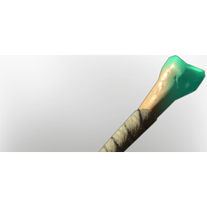 | [Bone Arrow](../items/ammunition/bone-arrow-1247095576.md) | ⚪ Common | 15 | 500 |
| 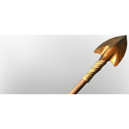 | [Bronze Arrow](../items/ammunition/bronze-arrow-3990911183.md) | ⚪ Common | 17 | 500 |
| 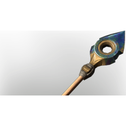 | [Celesthium Steel Arrow](../items/ammunition/celesthium-steel-arrow-2519697782.md) | ⚪ Common | 47 | 500 |
| 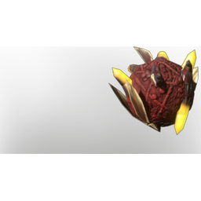 | [Common Bait](../items/ammunition/common-bait-1246545941.md) | ⚪ Common | 40 | 250 |
| 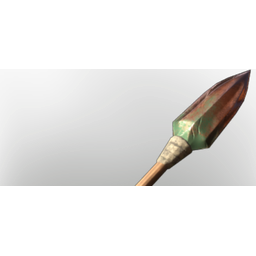 | [Copper Arrow](../items/ammunition/copper-arrow-4046432840.md) | ⚪ Common | 12 | 500 |
| 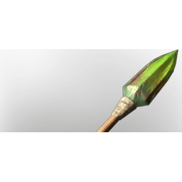 | [Copper Poison Arrow](../items/ammunition/copper-poison-arrow-2919301642.md) | ⚪ Common | 15 | 500 |
| 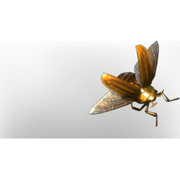 | [Desert Bug](../items/ammunition/desert-bug-700318057.md) | ⚪ Common | 25 | 250 |
| 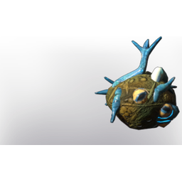 | [Epic Fishing Bait I](../items/ammunition/epic-fishing-bait-i-471470231.md) | 🟣 Epic | 40 | 250 |
| 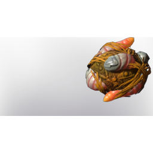 | [Epic Fishing Bait II](../items/ammunition/epic-fishing-bait-ii-3765704048.md) | 🟣 Epic | 45 | 250 |
| 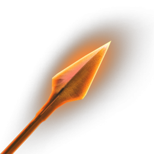 | [Eternal Fire Arrow I](../items/ammunition/eternal-fire-arrow-i-685713190.md) | 🔵 Rare | 15 | 1 |
| 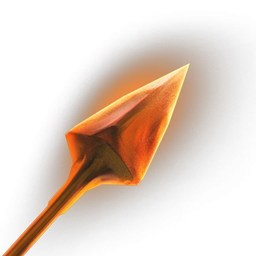 | [Eternal Fire Arrow II](../items/ammunition/eternal-fire-arrow-ii-225262139.md) | 🟣 Epic | 28 | 1 |
| 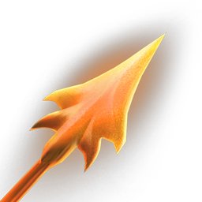 | [Eternal Fire Arrow III](../items/ammunition/eternal-fire-arrow-iii-678529367.md) | 🟠 Legendary | 45 | 1 |
|  | [Eternal Frost Arrow II](../items/ammunition/eternal-frost-arrow-ii-945340556.md) | 🟣 Epic | 28 | 1 |
| 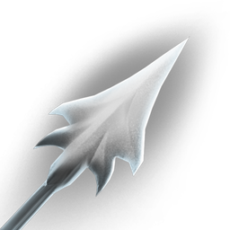 | [Eternal Frost Arrow III](../items/ammunition/eternal-frost-arrow-iii-3833476832.md) | 🟠 Legendary | 45 | 1 |
| 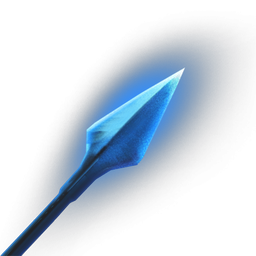 | [Eternal Shock Arrow I](../items/ammunition/eternal-shock-arrow-i-3133483038.md) | 🔵 Rare | 20 | 1 |
| 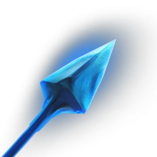 | [Eternal Shock Arrow II](../items/ammunition/eternal-shock-arrow-ii-2453015274.md) | 🟣 Epic | 36 | 1 |
| 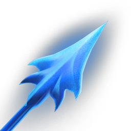 | [Eternal Shock Arrow III](../items/ammunition/eternal-shock-arrow-iii-2369196415.md) | 🟠 Legendary | 45 | 1 |
| 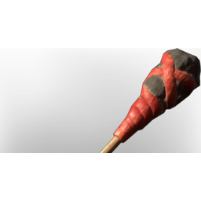 | [Exploding Arrow I](../items/ammunition/exploding-arrow-i-2040014559.md) | ⚪ Common | 15 | 500 |
| 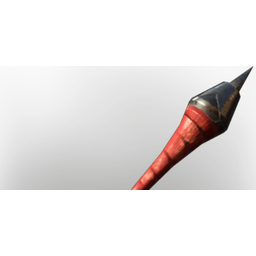 | [Exploding Arrow II](../items/ammunition/exploding-arrow-ii-1038927419.md) | ⚪ Common | 27 | 500 |
| 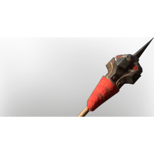 | [Exploding Arrow III](../items/ammunition/exploding-arrow-iii-3342011345.md) | ⚪ Common | 44 | 500 |
| 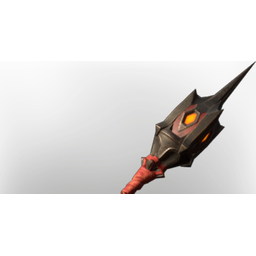 | [Exploding Arrow IV](../items/ammunition/exploding-arrow-iv-4160116201.md) | ⚪ Common | 50 | 500 |
| 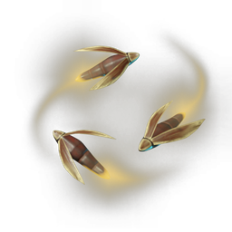 | [Fire Fly](../items/ammunition/fire-fly-1014899877.md) | ⚪ Common | 5 | 250 |
|  | [Fireworks](../items/ammunition/fireworks-1079068592.md) | 🔵 Rare | - | 20 |
|  | [Fireworks](../items/ammunition/fireworks-1679532175.md) | 🔵 Rare | - | 20 |
| 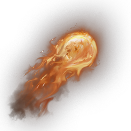 | [Fireworks](../items/ammunition/fireworks-2062654155.md) | 🔵 Rare | - | 20 |
|  | [Fireworks](../items/ammunition/fireworks-3332654176.md) | 🔵 Rare | - | 20 |
|  | [Fireworks](../items/ammunition/fireworks-403460397.md) | 🔵 Rare | - | 20 |
| 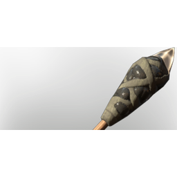 | [Flare Arrow](../items/ammunition/flare-arrow-3511177059.md) | ⚪ Common | 10 | 500 |
| 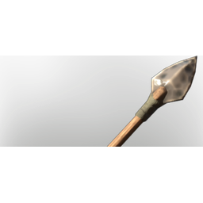 | [Flint Arrow](../items/ammunition/flint-arrow-1422216404.md) | ⚪ Common | 5 | 500 |
| 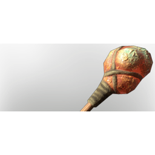 | [Fog Arrow](../items/ammunition/fog-arrow-3761680048.md) | ⚪ Common | 15 | 500 |
| 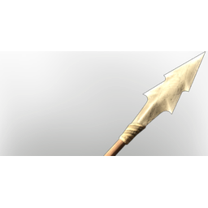 | [Fossilized Bone Arrow](../items/ammunition/fossilized-bone-arrow-1536235498.md) | ⚪ Common | 17 | 500 |
|  | [Frog](../items/ammunition/frog-3599394660.md) | ⚪ Common | 40 | 250 |
| 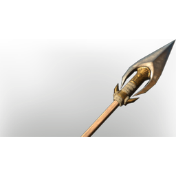 | [Golden Steel Arrow](../items/ammunition/golden-steel-arrow-3634108976.md) | ⚪ Common | 38 | 500 |
| 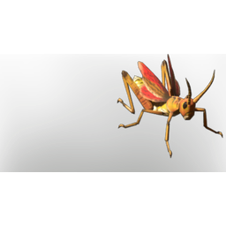 | [Grasshopper](../items/ammunition/grasshopper-2342031255.md) | ⚪ Common | 18 | 250 |
| 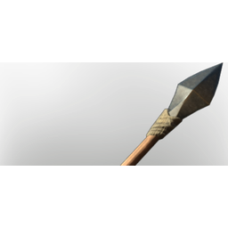 | [Iron Arrow](../items/ammunition/iron-arrow-1454438654.md) | ⚪ Common | 22 | 500 |
| 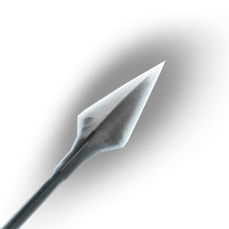 | [Magic Frost Arrow](../items/ammunition/magic-frost-arrow-397674071.md) | 🔵 Rare | 10 | 1 |
| 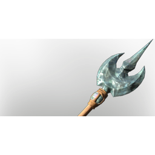 | [Moonstone Piercing Arrow](../items/ammunition/moonstone-piercing-arrow-832661139.md) | ⚪ Common | 47 | 500 |
| 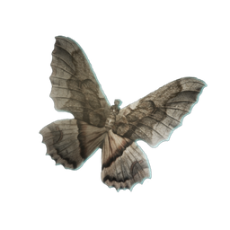 | [Moth](../items/ammunition/moth-2201448182.md) | ⚪ Common | 13 | 250 |
| 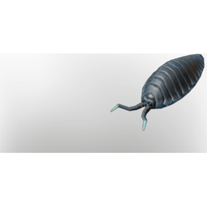 | [Mountains Insect](../items/ammunition/mountains-insect-1951407227.md) | ⚪ Common | 33 | 250 |
| 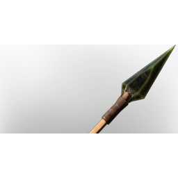 | [Obsidian Arrow](../items/ammunition/obsidian-arrow-2172551026.md) | ⚪ Common | 30 | 500 |
| 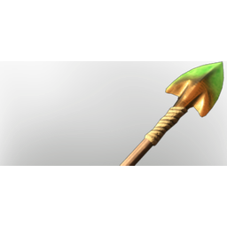 | [Poisoned Bronze Arrow](../items/ammunition/poisoned-bronze-arrow-551568007.md) | ⚪ Common | 20 | 500 |
| 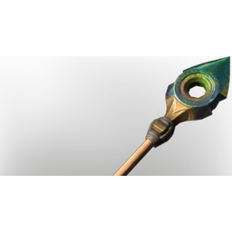 | [Poisoned Celesthium Steel Arrow](../items/ammunition/poisoned-celesthium-steel-arrow-2685638060.md) | ⚪ Common | 50 | 500 |
| 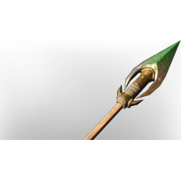 | [Poisoned Golden Steel Arrow](../items/ammunition/poisoned-golden-steel-arrow-1050570715.md) | ⚪ Common | 44 | 500 |
| 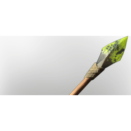 | [Poisoned Iron Arrow](../items/ammunition/poisoned-iron-arrow-2369582730.md) | ⚪ Common | 27 | 500 |
| 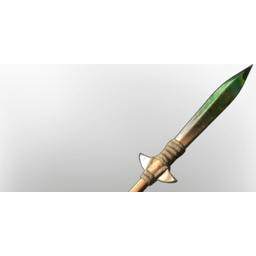 | [Poisoned Steel Arrow](../items/ammunition/poisoned-steel-arrow-103008069.md) | ⚪ Common | 35 | 500 |
| 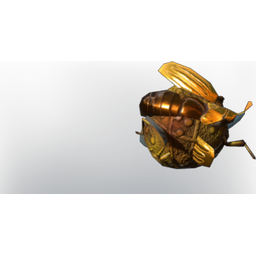 | [Rare Bait](../items/ammunition/rare-bait-1313427371.md) | 🔵 Rare | 40 | 250 |
| 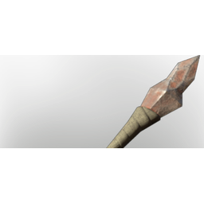 | [Scrap Arrow](../items/ammunition/scrap-arrow-1729479389.md) | ⚪ Common | 10 | 500 |
| 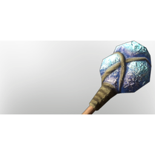 | [Shroud Arrow II](../items/ammunition/shroud-arrow-ii-4214162606.md) | ⚪ Common | 35 | 500 |
| 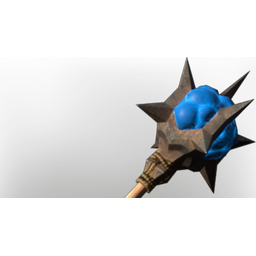 | [Shroud Arrow III](../items/ammunition/shroud-arrow-iii-3333535459.md) | ⚪ Common | 50 | 500 |
| 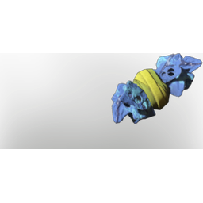 | [Simple Fishing Bait](../items/ammunition/simple-fishing-bait-3151503945.md) | ⚪ Common | 5 | 250 |
| 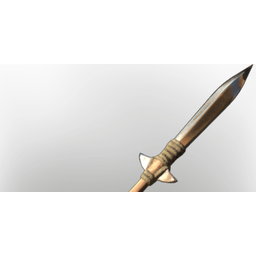 | [Steel Arrow](../items/ammunition/steel-arrow-3559583218.md) | ⚪ Common | 30 | 500 |
| 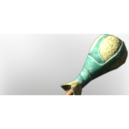 | [Stun Arrow](../items/ammunition/stun-arrow-2371220722.md) | ⚪ Common | 20 | 500 |
| 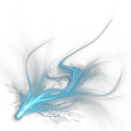 | [T0 Eternal Mana Leech Beam I](../items/ammunition/t0-eternal-mana-leech-beam-i-1707587232.md) | ⚪ Common | 3 | 1 |
|  | [T0 Fire Bolt I](../items/ammunition/t0-fire-bolt-i-2401631770.md) | ⚪ Common | 3 | 500 |
| 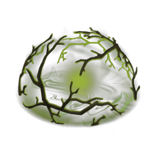 | [T1 Entangle I](../items/ammunition/t1-entangle-i-1843940779.md) | ⚪ Common | 5 | 500 |
|  | [T1 Eternal Ice Bolt I](../items/ammunition/t1-eternal-ice-bolt-i-1390932160.md) | 🔵 Rare | 5 | 1 |
|  | [T1 Eternal Mana Leech Beam II](../items/ammunition/t1-eternal-mana-leech-beam-ii-4241750567.md) | ⚪ Common | 5 | 1 |
|  | [T1 Fire Bolt II](../items/ammunition/t1-fire-bolt-ii-875842012.md) | ⚪ Common | 5 | 500 |
|  | [T1 Fireball I](../items/ammunition/t1-fireball-i-3918049792.md) | ⚪ Common | 10 | 500 |
|  | [T1 Heal Channel I](../items/ammunition/t1-heal-channel-i-1899806950.md) | ⚪ Common | 5 | 500 |
|  | [T1 Ice Bolt I](../items/ammunition/t1-ice-bolt-i-3169292847.md) | ⚪ Common | 5 | 500 |
|  | [T2 Blizzard I](../items/ammunition/t2-blizzard-i-1614683414.md) | ⚪ Common | 15 | 500 |
| 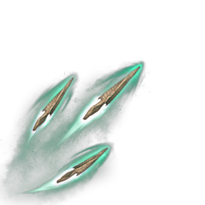 | [T2 Bone Channel I](../items/ammunition/t2-bone-channel-i-147615610.md) | ⚪ Common | 15 | 500 |
| 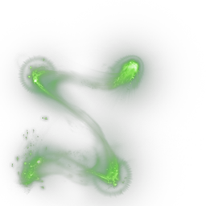 | [T2 Chain Heal I](../items/ammunition/t2-chain-heal-i-3878494540.md) | ⚪ Common | 12 | 500 |
|  | [T2 Chain Lightning I](../items/ammunition/t2-chain-lightning-i-1048548069.md) | ⚪ Common | 12 | 500 |
|  | [T2 Eternal Chain Lightning I](../items/ammunition/t2-eternal-chain-lightning-i-1611551751.md) | 🔵 Rare | 10 | 1 |
|  | [T2 Eternal Mana Leech Beam III](../items/ammunition/t2-eternal-mana-leech-beam-iii-711941661.md) | ⚪ Common | 12 | 1 |
|  | [T2 Fire Bolt III](../items/ammunition/t2-fire-bolt-iii-1790474262.md) | ⚪ Common | 12 | 500 |
|  | [T2 Fireball II](../items/ammunition/t2-fireball-ii-1833734179.md) | ⚪ Common | 15 | 500 |
|  | [T2 Ice Bolt II](../items/ammunition/t2-ice-bolt-ii-2728050036.md) | ⚪ Common | 12 | 500 |
|  | [T2 Pillar of Flames I](../items/ammunition/t2-pillar-of-flames-i-901722888.md) | ⚪ Common | 12 | 500 |
|  | [T2 Shock Wisp I](../items/ammunition/t2-shock-wisp-i-2875641903.md) | ⚪ Common | 12 | 500 |
|  | [T3 Acid Cone](../items/ammunition/t3-acid-cone-471823515.md) | ⚪ Common | 17 | 500 |
|  | [T3 Ball Lightning](../items/ammunition/t3-ball-lightning-1735403844.md) | ⚪ Common | 20 | 500 |
|  | [T3 Bone Channel II](../items/ammunition/t3-bone-channel-ii-3045356884.md) | ⚪ Common | 20 | 500 |
|  | [T3 Entangle II](../items/ammunition/t3-entangle-ii-1100793430.md) | ⚪ Common | 17 | 500 |
|  | [T3 Eternal Chain Heal I](../items/ammunition/t3-eternal-chain-heal-i-1203301438.md) | 🟣 Epic | 15 | 1 |
|  | [T3 Eternal Fireball I](../items/ammunition/t3-eternal-fireball-i-1912744772.md) | 🔵 Rare | 15 | 1 |
|  | [T3 Eternal Ice Bolt II](../items/ammunition/t3-eternal-ice-bolt-ii-521600917.md) | 🟣 Epic | 15 | 1 |
|  | [T3 Eternal Mana Leech Beam IV](../items/ammunition/t3-eternal-mana-leech-beam-iv-2591238243.md) | ⚪ Common | 17 | 1 |
|  | [T3 Fire Bolt IV](../items/ammunition/t3-fire-bolt-iv-3498203616.md) | ⚪ Common | 17 | 500 |
|  | [T3 Fire Totem](../items/ammunition/t3-fire-totem-2830104367.md) | ⚪ Common | 17 | 500 |
|  | [T3 Giant Bone Arrow I](../items/ammunition/t3-giant-bone-arrow-i-2091572334.md) | ⚪ Common | 20 | 500 |
|  | [T3 Ice Totem I](../items/ammunition/t3-ice-totem-i-632849243.md) | ⚪ Common | 17 | 500 |
|  | [T3 Light Burst](../items/ammunition/t3-light-burst-738997972.md) | ⚪ Common | 17 | 500 |
|  | [T3 Shock Totem I](../items/ammunition/t3-shock-totem-i-4044132453.md) | ⚪ Common | 17 | 500 |
|  | [T3 Summon Skeleton I](../items/ammunition/t3-summon-skeleton-i-1250423976.md) | ⚪ Common | 17 | 500 |
|  | [T4 Blizzard II](../items/ammunition/t4-blizzard-ii-621614770.md) | ⚪ Common | 22 | 500 |
|  | [T4 Bone Channel III](../items/ammunition/t4-bone-channel-iii-3014702000.md) | ⚪ Common | 27 | 500 |
|  | [T4 Eternal Acid Cone I](../items/ammunition/t4-eternal-acid-cone-i-4291668892.md) | 🟣 Epic | 20 | 1 |
|  | [T4 Eternal Heal Channel I](../items/ammunition/t4-eternal-heal-channel-i-2337136795.md) | 🟣 Epic | 20 | 1 |
|  | [T4 Eternal Ice Totem I](../items/ammunition/t4-eternal-ice-totem-i-1138260679.md) | 🟣 Epic | 20 | 1 |
|  | [T4 Eternal Light Burst I](../items/ammunition/t4-eternal-light-burst-i-72192472.md) | 🟣 Epic | 20 | 1 |
|  | [T4 Eternal Mana Leech Beam V](../items/ammunition/t4-eternal-mana-leech-beam-v-289913176.md) | ⚪ Common | 22 | 1 |
|  | [T4 Eternal Shock Wisp I](../items/ammunition/t4-eternal-shock-wisp-i-1937493913.md) | 🟣 Epic | 20 | 1 |
|  | [T4 Fire Bolt V](../items/ammunition/t4-fire-bolt-v-2781335650.md) | ⚪ Common | 22 | 500 |
|  | [T4 Giant Bone Arrow II](../items/ammunition/t4-giant-bone-arrow-ii-3270347800.md) | ⚪ Common | 27 | 500 |
|  | [T4 Heal Beam Channel](../items/ammunition/t4-heal-beam-channel-1087441899.md) | ⚪ Common | 27 | 500 |
|  | [T4 Lightning Channel](../items/ammunition/t4-lightning-channel-1685866698.md) | ⚪ Common | 22 | 500 |
|  | [T4 Pillar of Flames II](../items/ammunition/t4-pillar-of-flames-ii-1805048399.md) | ⚪ Common | 22 | 500 |
|  | [T4 Shroud Meteor](../items/ammunition/t4-shroud-meteor-3940653429.md) | ⚪ Common | 27 | 500 |
|  | [T5 Ball Lightning](../items/ammunition/t5-ball-lightning-1822034736.md) | ⚪ Common | 30 | 500 |
|  | [T5 Bone Channel IV](../items/ammunition/t5-bone-channel-iv-4222822690.md) | ⚪ Common | 35 | 500 |
|  | [T5 Chain Heal II](../items/ammunition/t5-chain-heal-ii-3216582163.md) | ⚪ Common | 35 | 500 |
|  | [T5 Entangle III](../items/ammunition/t5-entangle-iii-1774181330.md) | ⚪ Common | 30 | 500 |
|  | [T5 Eternal Blizzard I](../items/ammunition/t5-eternal-blizzard-i-4195393452.md) | 🟣 Epic | 28 | 1 |
|  | [T5 Eternal Chain Lightning II](../items/ammunition/t5-eternal-chain-lightning-ii-2774889835.md) | 🟣 Epic | 28 | 1 |
|  | [T5 Eternal Fire Totem I](../items/ammunition/t5-eternal-fire-totem-i-3172618647.md) | 🟣 Epic | 28 | 1 |
|  | [T5 Eternal Mana Leech Beam VI](../items/ammunition/t5-eternal-mana-leech-beam-vi-2971039479.md) | ⚪ Common | 30 | 1 |
|  | [T5 Eternal Summon Skeleton I](../items/ammunition/t5-eternal-summon-skeleton-i-3759493341.md) | 🟣 Epic | 28 | 1 |
|  | [T5 Fire Bolt VI](../items/ammunition/t5-fire-bolt-vi-2506485819.md) | ⚪ Common | 30 | 500 |
|  | [T5 Fireball III](../items/ammunition/t5-fireball-iii-1356876810.md) | ⚪ Common | 30 | 500 |
|  | [T5 Giant Bone Arrow III](../items/ammunition/t5-giant-bone-arrow-iii-2941384776.md) | ⚪ Common | 35 | 500 |
|  | [T5 Ice Bolt III](../items/ammunition/t5-ice-bolt-iii-1533278840.md) | ⚪ Common | 30 | 500 |
|  | [T5 Shroud Beam Channel](../items/ammunition/t5-shroud-beam-channel-2153855871.md) | ⚪ Common | 30 | 500 |
|  | [T6 Bone Channel V](../items/ammunition/t6-bone-channel-v-4054999373.md) | ⚪ Common | 38 | 500 |
|  | [T6 Eternal Bone Channel I](../items/ammunition/t6-eternal-bone-channel-i-1887970091.md) | 🟣 Epic | 36 | 1 |
|  | [T6 Eternal Fireball II](../items/ammunition/t6-eternal-fireball-ii-1334157650.md) | 🟣 Epic | 36 | 1 |
|  | [T6 Eternal Giant Bone Arrow I](../items/ammunition/t6-eternal-giant-bone-arrow-i-1610169156.md) | 🟣 Epic | 36 | 1 |
|  | [T6 Eternal Heal Beam Channel I](../items/ammunition/t6-eternal-heal-beam-channel-i-1625866381.md) | 🟣 Epic | 36 | 1 |
|  | [T6 Eternal Ice Bolt III](../items/ammunition/t6-eternal-ice-bolt-iii-2029595221.md) | 🟠 Legendary | 36 | 1 |
|  | [T6 Eternal Lightning Channel I](../items/ammunition/t6-eternal-lightning-channel-i-1389638766.md) | 🟣 Epic | 36 | 1 |
|  | [T6 Eternal Mana Leech Beam VII](../items/ammunition/t6-eternal-mana-leech-beam-vii-2404490725.md) | ⚪ Common | 38 | 1 |
|  | [T6 Fire Bolt VII](../items/ammunition/t6-fire-bolt-vii-2583959345.md) | ⚪ Common | 38 | 500 |
|  | [T6 Giant Bone Arrow IV](../items/ammunition/t6-giant-bone-arrow-iv-3600953136.md) | ⚪ Common | 38 | 500 |
|  | [T6 Ice Totem II](../items/ammunition/t6-ice-totem-ii-3960177886.md) | ⚪ Common | 38 | 500 |
|  | [T6 Magic Shield](../items/ammunition/t6-magic-shield-1713565263.md) | ⚪ Common | 38 | 500 |
|  | [T6 Pillar of Flames III](../items/ammunition/t6-pillar-of-flames-iii-111980330.md) | ⚪ Common | 44 | 500 |
|  | [T6 Shock Totem II](../items/ammunition/t6-shock-totem-ii-3046388897.md) | ⚪ Common | 38 | 500 |
|  | [T6 Shock Wisp III](../items/ammunition/t6-shock-wisp-iii-396873784.md) | ⚪ Common | 38 | 500 |
|  | [T6 Summon Skeleton II](../items/ammunition/t6-summon-skeleton-ii-4252546627.md) | ⚪ Common | 44 | 500 |
|  | [T7 Blunt Arrow](../items/ammunition/t7-blunt-arrow-1677413497.md) | ⚪ Common | 47 | 500 |
|  | [T7 Chain Lightning II](../items/ammunition/t7-chain-lightning-ii-2894776039.md) | ⚪ Common | 47 | 500 |
|  | [T7 Eternal Acid Cone II](../items/ammunition/t7-eternal-acid-cone-ii-1674086102.md) | 🟠 Legendary | 45 | 1 |
|  | [T7 Eternal Ball Lightning](../items/ammunition/t7-eternal-ball-lightning-2369199112.md) | 🟠 Legendary | 45 | 1 |
|  | [T7 Eternal Blizzard II](../items/ammunition/t7-eternal-blizzard-ii-3381945830.md) | 🟠 Legendary | 45 | 1 |
|  | [T7 Eternal Bone Channel II](../items/ammunition/t7-eternal-bone-channel-ii-297685721.md) | 🟠 Legendary | 45 | 1 |
|  | [T7 Eternal Chain Heal II](../items/ammunition/t7-eternal-chain-heal-ii-1375984897.md) | 🟠 Legendary | 45 | 1 |
|  | [T7 Eternal Chain Lightning III](../items/ammunition/t7-eternal-chain-lightning-iii-1943367547.md) | 🟠 Legendary | 45 | 1 |
|  | [T7 Eternal Entangle](../items/ammunition/t7-eternal-entangle-967466975.md) | 🔵 Rare | 45 | 1 |
|  | [T7 Eternal Fire Totem II](../items/ammunition/t7-eternal-fire-totem-ii-3916550351.md) | 🟠 Legendary | 45 | 1 |
|  | [T7 Eternal Fireball III](../items/ammunition/t7-eternal-fireball-iii-3838422264.md) | 🟠 Legendary | 45 | 1 |
|  | [T7 Eternal Giant Bone Arrow II](../items/ammunition/t7-eternal-giant-bone-arrow-ii-334395711.md) | 🟠 Legendary | 45 | 1 |
|  | [T7 Eternal Heal Beam Channel II](../items/ammunition/t7-eternal-heal-beam-channel-ii-2753909436.md) | 🟠 Legendary | 45 | 1 |
|  | [T7 Eternal Heal Channel II](../items/ammunition/t7-eternal-heal-channel-ii-61698870.md) | 🟠 Legendary | 45 | 1 |
|  | [T7 Eternal Ice Bolt IV](../items/ammunition/t7-eternal-ice-bolt-iv-1144190206.md) | 🟠 Legendary | 45 | 1 |
|  | [T7 Eternal Ice Totem II](../items/ammunition/t7-eternal-ice-totem-ii-3681008420.md) | 🟠 Legendary | 45 | 1 |
|  | [T7 Eternal Light Burst II](../items/ammunition/t7-eternal-light-burst-ii-377316946.md) | 🟠 Legendary | 45 | 1 |
|  | [T7 Eternal Lightning Channel II](../items/ammunition/t7-eternal-lightning-channel-ii-3901795018.md) | 🟠 Legendary | 45 | 1 |
|  | [T7 Eternal Magic Shield](../items/ammunition/t7-eternal-magic-shield-1408904500.md) | 🔵 Rare | 45 | 1 |
|  | [T7 Eternal Mana Leech Beam VIII](../items/ammunition/t7-eternal-mana-leech-beam-viii-2032176232.md) | ⚪ Common | 47 | 1 |
|  | [T7 Eternal Pillar of Flames](../items/ammunition/t7-eternal-pillar-of-flames-3180367619.md) | 🟠 Legendary | 45 | 1 |
|  | [T7 Eternal Shock Totem](../items/ammunition/t7-eternal-shock-totem-3694023795.md) | 🟠 Legendary | 45 | 1 |
|  | [T7 Eternal Shock Wisp](../items/ammunition/t7-eternal-shock-wisp-1209734633.md) | 🟠 Legendary | 45 | 1 |
|  | [T7 Eternal Shroud Beam Channel](../items/ammunition/t7-eternal-shroud-beam-channel-803538053.md) | 🟠 Legendary | 45 | 1 |
|  | [T7 Eternal Shroud Meteor](../items/ammunition/t7-eternal-shroud-meteor-1835123088.md) | 🟠 Legendary | 45 | 1 |
|  | [T7 Eternal Summon Skeleton II](../items/ammunition/t7-eternal-summon-skeleton-ii-3370079249.md) | 🟠 Legendary | 45 | 1 |
|  | [T7 Fire Bolt VIII](../items/ammunition/t7-fire-bolt-viii-381093769.md) | ⚪ Common | 47 | 500 |
|  | [T7 Fireball](../items/ammunition/t7-fireball-83283491.md) | ⚪ Common | 47 | 500 |
|  | [T7 Heal Channel II](../items/ammunition/t7-heal-channel-ii-1958601376.md) | ⚪ Common | 47 | 500 |
|  | [T7 Ice Bolt IV](../items/ammunition/t7-ice-bolt-iv-780965247.md) | ⚪ Common | 47 | 500 |
|  | [Trap Fireball](../items/ammunition/trap-fireball-1006313599.md) | 🔵 Rare | - | 20 |
|  | [Trap Fireball](../items/ammunition/trap-fireball-1571663933.md) | 🔵 Rare | - | 20 |
|  | [Trap Fireball](../items/ammunition/trap-fireball-1654015901.md) | 🔵 Rare | - | 20 |
|  | [Trap Fireball](../items/ammunition/trap-fireball-1668003136.md) | 🔵 Rare | - | 20 |
|  | [Trap Fireball](../items/ammunition/trap-fireball-1756403655.md) | 🔵 Rare | - | 20 |
|  | [Trap Fireball](../items/ammunition/trap-fireball-1978739882.md) | 🔵 Rare | - | 20 |
|  | [Trap Fireball](../items/ammunition/trap-fireball-2269127555.md) | 🔵 Rare | - | 20 |
|  | [Trap Fireball](../items/ammunition/trap-fireball-2431804622.md) | 🔵 Rare | - | 20 |
|  | [Trap Fireball](../items/ammunition/trap-fireball-2467156641.md) | 🔵 Rare | - | 20 |
|  | [Trap Fireball](../items/ammunition/trap-fireball-2872459908.md) | 🔵 Rare | - | 20 |
|  | [Uncommon Bait](../items/ammunition/uncommon-bait-2520666169.md) | 🟢 Uncommon | 40 | 250 |
|  | [Wooden Arrow](../items/ammunition/wooden-arrow-2956941513.md) | ⚪ Common | 3 | 500 |
|  | [Worms](../items/ammunition/worms-2482366505.md) | ⚪ Common | 45 | 250 |

[← All categories](../README.md)
