# Blueprints

63 items

| Icon | Name | Rarity | Level | Stack |
|:---:|---|---|:---:|:---:|
| 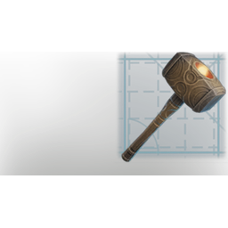 | [2x2 Terrain Blocks](../items/blueprints/2x2-terrain-blocks-3014325591.md) | ⚪ Common | - | 1 |
|  | [2x2 Wall Blocks](../items/blueprints/2x2-wall-blocks-280346668.md) | ⚪ Common | - | 1 |
|  | [Box 4m](../items/blueprints/box-4m-1269629155.md) | ⚪ Common | - | 1 |
|  | [Ceiling](../items/blueprints/ceiling-3338618487.md) | ⚪ Common | - | 1 |
|  | [Ceiling](../items/blueprints/ceiling-81726253.md) | ⚪ Common | - | 1 |
|  | [Celestium/Improved Decay Tool](../items/blueprints/celestium-improved-decay-tool-3672772460.md) | ⚪ Common | - | 1 |
|  | [Celestium/Improved Hammer of the Ancients](../items/blueprints/celestium-improved-hammer-of-the-ancients-1468357474.md) | ⚪ Common | - | 1 |
| 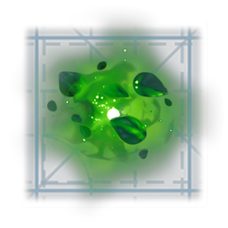 | [Celestium/Improved Overgrowth Tool](../items/blueprints/celestium-improved-overgrowth-tool-3145109238.md) | ⚪ Common | - | 1 |
|  | [Column Small](../items/blueprints/column-small-1337014067.md) | ⚪ Common | - | 1 |
|  | [Column Small](../items/blueprints/column-small-2223732257.md) | ⚪ Common | - | 1 |
|  | [Cube 2m](../items/blueprints/cube-2m-1831520365.md) | ⚪ Common | - | 1 |
| 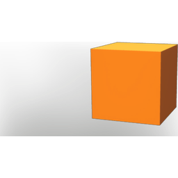 | [Cube 4m](../items/blueprints/cube-4m-3184017600.md) | ⚪ Common | - | 1 |
| 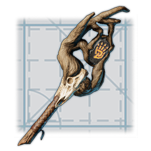 | [Decay Tool](../items/blueprints/decay-tool-3286071567.md) | ⚪ Common | - | 1 |
|  | [Disc 3m](../items/blueprints/disc-3m-1144423378.md) | ⚪ Common | - | 1 |
|  | [Foundation](../items/blueprints/foundation-3828821633.md) | ⚪ Common | - | 1 |
|  | [Foundation](../items/blueprints/foundation-950598916.md) | ⚪ Common | - | 1 |
| 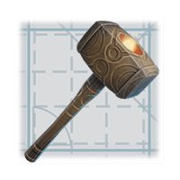 | [Hammer of the Ancients](../items/blueprints/hammer-of-the-ancients-693164685.md) | ⚪ Common | - | 1 |
|  | [Overgrowth Tool](../items/blueprints/overgrowth-tool-3196782416.md) | ⚪ Common | - | 1 |
|  | [Ramp 22° 2m](../items/blueprints/ramp-22-2m-1850744829.md) | ⚪ Common | - | 1 |
|  | [Ramp 22° 4m](../items/blueprints/ramp-22-4m-3842144121.md) | ⚪ Common | - | 1 |
|  | [Ramp 45° 2m](../items/blueprints/ramp-45-2m-1286568294.md) | ⚪ Common | - | 1 |
|  | [Ramp 45° 4m](../items/blueprints/ramp-45-4m-2981448748.md) | ⚪ Common | - | 1 |
|  | [Rock 2m](../items/blueprints/rock-2m-4131969045.md) | ⚪ Common | - | 1 |
|  | [Roof Block](../items/blueprints/roof-block-3137624464.md) | ⚪ Common | - | 1 |
|  | [Roof Corner In](../items/blueprints/roof-corner-in-2297453360.md) | ⚪ Common | - | 1 |
|  | [Roof Corner In](../items/blueprints/roof-corner-in-3722239847.md) | ⚪ Common | - | 1 |
|  | [Roof Corner Out](../items/blueprints/roof-corner-out-3000989055.md) | ⚪ Common | - | 1 |
|  | [Roof Corner Out](../items/blueprints/roof-corner-out-985540864.md) | ⚪ Common | - | 1 |
|  | [Roof Flat](../items/blueprints/roof-flat-1774062421.md) | ⚪ Common | - | 1 |
| 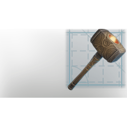 | [Roof Flat](../items/blueprints/roof-flat-4045909019.md) | ⚪ Common | - | 1 |
|  | [Roof Straight](../items/blueprints/roof-straight-1083013738.md) | ⚪ Common | - | 1 |
|  | [Roof Straight](../items/blueprints/roof-straight-2482289794.md) | ⚪ Common | - | 1 |
|  | [Roof Top Peak](../items/blueprints/roof-top-peak-3974598916.md) | ⚪ Common | - | 1 |
|  | [Roof Top Peak](../items/blueprints/roof-top-peak-4258530417.md) | ⚪ Common | - | 1 |
|  | [Roof Top Straight](../items/blueprints/roof-top-straight-3236763530.md) | ⚪ Common | - | 1 |
|  | [Roof Top Straight](../items/blueprints/roof-top-straight-40821618.md) | ⚪ Common | - | 1 |
|  | [Roof Top Straight End](../items/blueprints/roof-top-straight-end-1608103343.md) | ⚪ Common | - | 1 |
|  | [Roof Top Straight End](../items/blueprints/roof-top-straight-end-2639429240.md) | ⚪ Common | - | 1 |
|  | [Shape Big](../items/blueprints/shape-big-379859676.md) | ⚪ Common | - | 1 |
| 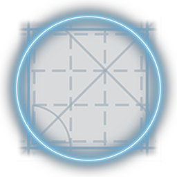 | [Shape Big](../items/blueprints/shape-big-89089003.md) | ⚪ Common | - | 1 |
|  | [Shape Medium](../items/blueprints/shape-medium-1456389031.md) | ⚪ Common | - | 1 |
| 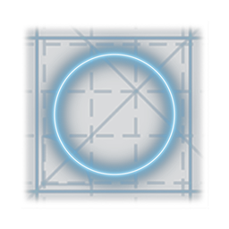 | [Shape Medium](../items/blueprints/shape-medium-473703809.md) | ⚪ Common | - | 1 |
|  | [Shape Small](../items/blueprints/shape-small-2962795698.md) | ⚪ Common | - | 1 |
| 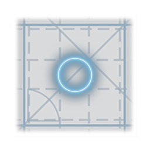 | [Shape Small](../items/blueprints/shape-small-439089072.md) | ⚪ Common | - | 1 |
|  | [Solid Foundation](../items/blueprints/solid-foundation-1136287074.md) | ⚪ Common | - | 1 |
|  | [Stair Small](../items/blueprints/stair-small-1740166566.md) | ⚪ Common | - | 1 |
|  | [Stair Small](../items/blueprints/stair-small-1982827643.md) | ⚪ Common | - | 1 |
|  | [Stair Small](../items/blueprints/stair-small-2108853004.md) | ⚪ Common | - | 1 |
| 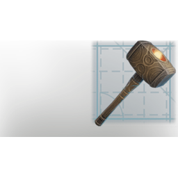 | [Stair Small](../items/blueprints/stair-small-3575993170.md) | ⚪ Common | - | 1 |
|  | [Terrain Block](../items/blueprints/terrain-block-3261257614.md) | ⚪ Common | - | 1 |
|  | [Wall](../items/blueprints/wall-48042626.md) | ⚪ Common | - | 1 |
|  | [Wall](../items/blueprints/wall-948722226.md) | ⚪ Common | - | 1 |
|  | [Wall Block](../items/blueprints/wall-block-1986896347.md) | ⚪ Common | - | 1 |
| 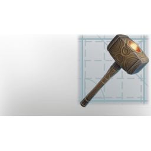 | [Wall Doorframe](../items/blueprints/wall-doorframe-2492886765.md) | ⚪ Common | - | 1 |
|  | [Wall Doorframe](../items/blueprints/wall-doorframe-2697997511.md) | ⚪ Common | - | 1 |
|  | [Wall Doorframe](../items/blueprints/wall-doorframe-3793200211.md) | ⚪ Common | - | 1 |
|  | [Wall Roof](../items/blueprints/wall-roof-2096316628.md) | ⚪ Common | - | 1 |
|  | [Wall Roof](../items/blueprints/wall-roof-457882098.md) | ⚪ Common | - | 1 |
|  | [Wall Roof Inverted](../items/blueprints/wall-roof-inverted-1444745133.md) | ⚪ Common | - | 1 |
|  | [Wall Roof Inverted](../items/blueprints/wall-roof-inverted-4211995022.md) | ⚪ Common | - | 1 |
|  | [Wall Small](../items/blueprints/wall-small-2221187965.md) | ⚪ Common | - | 1 |
|  | [Wall Window](../items/blueprints/wall-window-2481913049.md) | ⚪ Common | - | 1 |
|  | [Wall Window](../items/blueprints/wall-window-3474562068.md) | ⚪ Common | - | 1 |

[← All categories](../README.md)
