# Building

1556 items · page [1](buildtools.md) · **2** · [3](buildtools-3.md) · [4](buildtools-4.md) · [5](buildtools-5.md) · [6](buildtools-6.md)

| Icon | Name | Rarity | Level | Stack |
|:---:|---|---|:---:|:---:|
|  | [Carved Secret Bookshelf Door](../items/buildtools/carved-secret-bookshelf-door-2073402181.md) | 🔵 Rare | - | 50 |
| 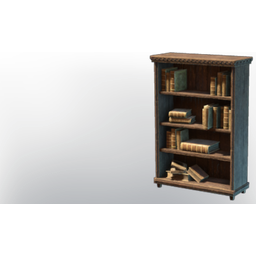 | [Carved Secret Bookshelf Door](../items/buildtools/carved-secret-bookshelf-door-3126384595.md) | 🔵 Rare | - | 50 |
| 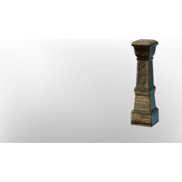 | [Carved Tropical Wood Fence Pole](../items/buildtools/carved-tropical-wood-fence-pole-161588181.md) | ⚪ Common | - | 50 |
| 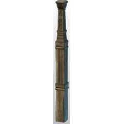 | [Carved Tropical Wood Fence Pole](../items/buildtools/carved-tropical-wood-fence-pole-1698793327.md) | ⚪ Common | - | 50 |
| 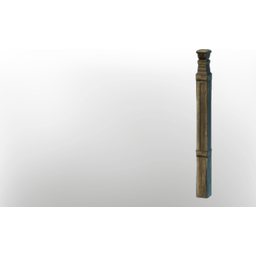 | [Carved Tropical Wood Fence Pole](../items/buildtools/carved-tropical-wood-fence-pole-2429035331.md) | ⚪ Common | - | 50 |
| 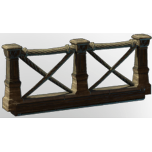 | [Carved Tropical Wood Fence with Ropes I](../items/buildtools/carved-tropical-wood-fence-with-ropes-i-2339691082.md) | ⚪ Common | - | 50 |
|  | [Carved Tropical Wood Fence with Ropes II](../items/buildtools/carved-tropical-wood-fence-with-ropes-ii-1736007350.md) | ⚪ Common | - | 50 |
| 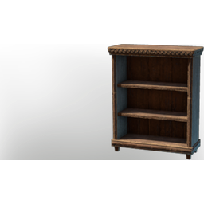 | [Carved Wooden Cabinet](../items/buildtools/carved-wooden-cabinet-3843129052.md) | ⚪ Common | - | 50 |
| 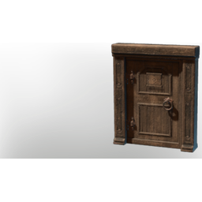 | [Carved Wooden Door](../items/buildtools/carved-wooden-door-2321570331.md) | ⚪ Common | - | 50 |
| 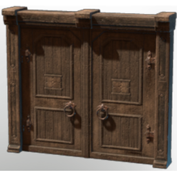 | [Carved Wooden Double Door](../items/buildtools/carved-wooden-double-door-3966046547.md) | ⚪ Common | - | 50 |
| 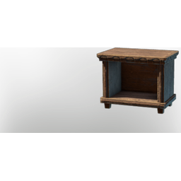 | [Carved Wooden Nightstand](../items/buildtools/carved-wooden-nightstand-3600031474.md) | ⚪ Common | - | 50 |
| 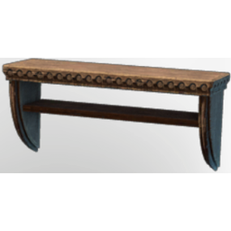 | [Carved Wooden Shelf](../items/buildtools/carved-wooden-shelf-351167790.md) | ⚪ Common | - | 50 |
| 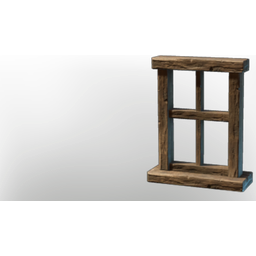 | [Carved Wooden Window Frame](../items/buildtools/carved-wooden-window-frame-3372636314.md) | ⚪ Common | - | 50 |
|  | [Carved Wooden Window Frame](../items/buildtools/carved-wooden-window-frame-3848003771.md) | ⚪ Common | - | 50 |
| 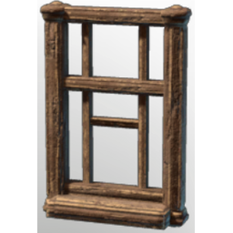 | [Carved Wooden Window Frame II](../items/buildtools/carved-wooden-window-frame-ii-2586499966.md) | ⚪ Common | - | 50 |
| 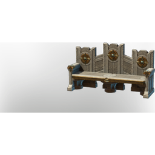 | [Castle Bench](../items/buildtools/castle-bench-3143381943.md) | ⚪ Common | - | 50 |
| 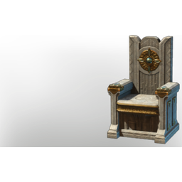 | [Castle Chair](../items/buildtools/castle-chair-3873995576.md) | ⚪ Common | - | 50 |
| 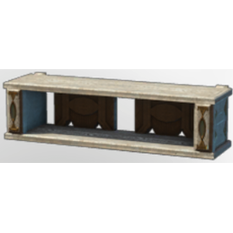 | [Castle Shelf](../items/buildtools/castle-shelf-4088362201.md) | ⚪ Common | - | 50 |
|  | [Castle Wall Secret](../items/buildtools/castle-wall-secret-22389632.md) | 🔵 Rare | - | 50 |
| 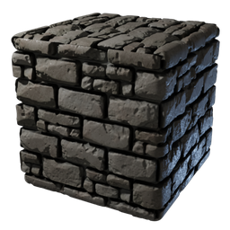 | [Castle Wall Stone Block](../items/buildtools/castle-wall-stone-block-1506458989.md) | ⚪ Common | - | 5000 |
| 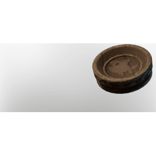 | [Cat Bowl](../items/buildtools/cat-bowl-2982586489.md) | ⚪ Common | - | 50 |
| 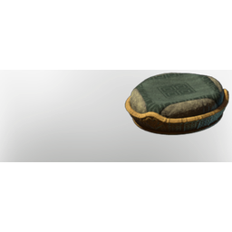 | [Cat Pillow](../items/buildtools/cat-pillow-654842831.md) | ⚪ Common | - | 50 |
|  | [Catdeer](../items/buildtools/catdeer-1195343032.md) | ⚪ Common | - | 1 |
| 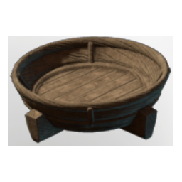 | [Catdeer Feeder](../items/buildtools/catdeer-feeder-3555557294.md) | ⚪ Common | - | 50 |
|  | [Cattail Seedling](../items/buildtools/cattail-seedling-842838716.md) | ⚪ Common | - | 100 |
|  | [Cauldron](../items/buildtools/cauldron-311508484.md) | 🔵 Rare | - | 1 |
| 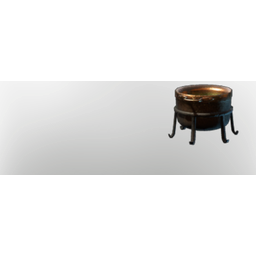 | [Cauldron](../items/buildtools/cauldron-3119388545.md) | ⚪ Common | - | 1 |
|  | [Ceiling Lantern](../items/buildtools/ceiling-lantern-2231847922.md) | ⚪ Common | - | 50 |
| 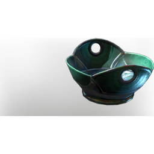 | [Celestium Bowl](../items/buildtools/celestium-bowl-824995482.md) | ⚪ Common | - | 50 |
| 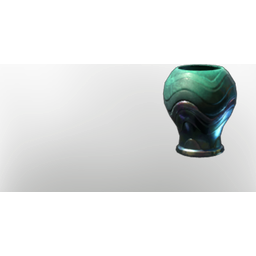 | [Celestium Cup](../items/buildtools/celestium-cup-629640210.md) | ⚪ Common | - | 50 |
| 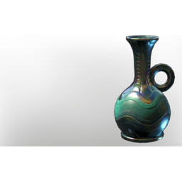 | [Celestium Jug](../items/buildtools/celestium-jug-3204624954.md) | ⚪ Common | - | 50 |
| 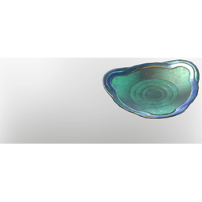 | [Celestium Platter](../items/buildtools/celestium-platter-3591471319.md) | ⚪ Common | - | 50 |
| 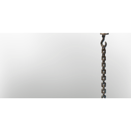 | [Chain](../items/buildtools/chain-2279483419.md) | ⚪ Common | - | 20 |
| 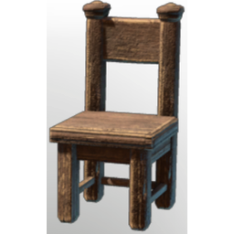 | [Chair T1](../items/buildtools/chair-t1-3714026425.md) | ⚪ Common | - | 50 |
|  | [Chair T2](../items/buildtools/chair-t2-1890067674.md) | ⚪ Common | - | 50 |
| 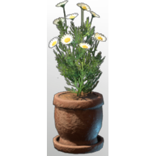 | [Chamomile Flower Pot](../items/buildtools/chamomile-flower-pot-2215362525.md) | ⚪ Common | - | 50 |
| 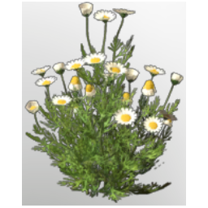 | [Chamomile Seedling](../items/buildtools/chamomile-seedling-2542499127.md) | ⚪ Common | - | 100 |
| 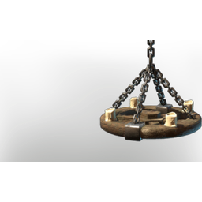 | [Chandelier](../items/buildtools/chandelier-1464322006.md) | ⚪ Common | - | 50 |
| 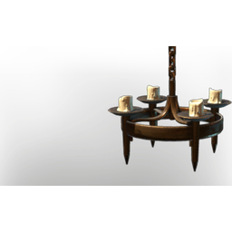 | [Chandelier](../items/buildtools/chandelier-3129268711.md) | ⚪ Common | - | 50 |
| 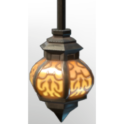 | [Chandelier](../items/buildtools/chandelier-4178847220.md) | ⚪ Common | - | 50 |
|  | [Channelled Water Tool](../items/buildtools/channelled-water-tool-1053852637.md) | 🟣 Epic | 40 | 1 |
|  | [Chanterelle Seedling](../items/buildtools/chanterelle-seedling-1783208373.md) | ⚪ Common | - | 100 |
|  | [Charcoal Kiln](../items/buildtools/charcoal-kiln-367322414.md) | 🔵 Rare | - | 1 |
| 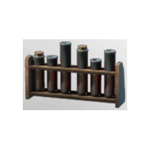 | [Chemistry Set 01](../items/buildtools/chemistry-set-01-461254565.md) | ⚪ Common | - | 500 |
|  | [Chemistry Set 02](../items/buildtools/chemistry-set-02-3018429826.md) | ⚪ Common | - | 1 |
|  | [Chester Loft](../items/buildtools/chester-loft-279729468.md) | 🔵 Rare | - | 1 |
|  | [City Wall Stone Block](../items/buildtools/city-wall-stone-block-1956408861.md) | ⚪ Common | - | 5000 |
|  | [City Wall Stone Block](../items/buildtools/city-wall-stone-block-3379333313.md) | ⚪ Common | - | 5000 |
|  | [Clay Bowl](../items/buildtools/clay-bowl-1787218857.md) | ⚪ Common | - | 50 |
| 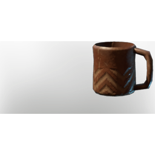 | [Clay Cup](../items/buildtools/clay-cup-2370176830.md) | ⚪ Common | - | 50 |
| 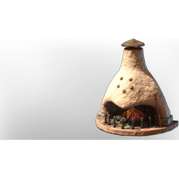 | [Clay Fire Place](../items/buildtools/clay-fire-place-1910038255.md) | ⚪ Common | - | 50 |
| 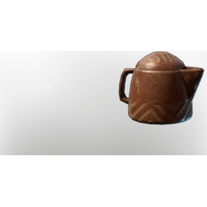 | [Clay Jug](../items/buildtools/clay-jug-881092637.md) | ⚪ Common | - | 50 |
| 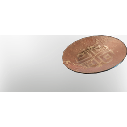 | [Clay Platter](../items/buildtools/clay-platter-1810030411.md) | ⚪ Common | - | 50 |
| 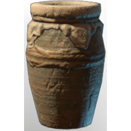 | [Clay Pot I](../items/buildtools/clay-pot-i-3614168339.md) | ⚪ Common | - | 50 |
|  | [Clay Pot II](../items/buildtools/clay-pot-ii-2130276313.md) | ⚪ Common | - | 50 |
| 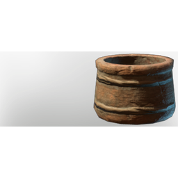 | [Clay Pot III](../items/buildtools/clay-pot-iii-257051972.md) | ⚪ Common | - | 50 |
| 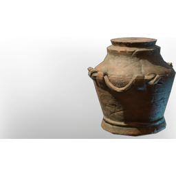 | [Clay Pot IV](../items/buildtools/clay-pot-iv-991797562.md) | ⚪ Common | - | 50 |
|  | [Clay tea Cup](../items/buildtools/clay-tea-cup-2487385039.md) | ⚪ Common | - | 50 |
| 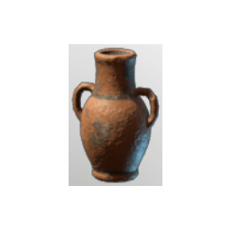 | [Clay Vase I](../items/buildtools/clay-vase-i-3982875414.md) | ⚪ Common | - | 50 |
| 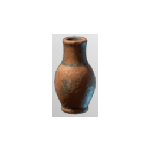 | [Clay Vase II](../items/buildtools/clay-vase-ii-781671616.md) | ⚪ Common | - | 50 |
| 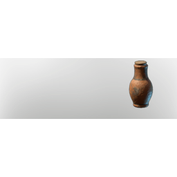 | [Clay Vase III](../items/buildtools/clay-vase-iii-1447953213.md) | ⚪ Common | - | 50 |
|  | [Clay Vase IV](../items/buildtools/clay-vase-iv-1410543018.md) | ⚪ Common | - | 50 |
| 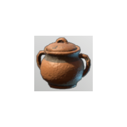 | [Clay Vase V](../items/buildtools/clay-vase-v-4154483367.md) | ⚪ Common | - | 50 |
| 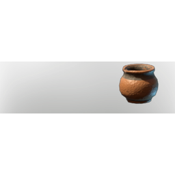 | [Clay Vase VI](../items/buildtools/clay-vase-vi-2244788593.md) | ⚪ Common | - | 50 |
|  | [Climbing Rose overgrowth plant](../items/buildtools/climbing-rose-overgrowth-plant-779558916.md) | ⚪ Common | 13 | 1000 |
| 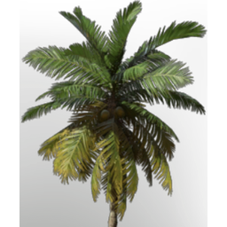 | [Coconut Palm Seedling](../items/buildtools/coconut-palm-seedling-1826599026.md) | ⚪ Common | - | 100 |
| 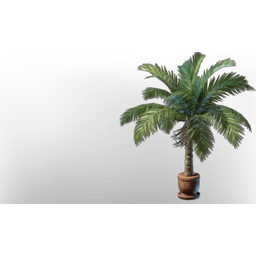 | [Coconut Plant Pot](../items/buildtools/coconut-plant-pot-529262830.md) | ⚪ Common | - | 50 |
|  | [Coffee Roastery](../items/buildtools/coffee-roastery-2068629527.md) | 🔵 Rare | - | 1 |
| 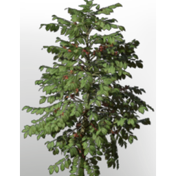 | [Coffee Seedling](../items/buildtools/coffee-seedling-3358339224.md) | ⚪ Common | - | 100 |
| 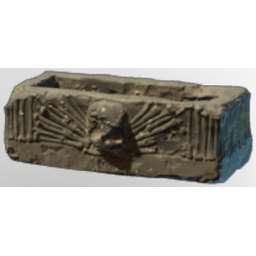 | [Coffin](../items/buildtools/coffin-4224532456.md) | ⚪ Common | - | 20 |
|  | [Coffin Lid](../items/buildtools/coffin-lid-4091387567.md) | ⚪ Common | - | 20 |
|  | [Collection of Books I](../items/buildtools/collection-of-books-i-1276880412.md) | ⚪ Common | - | 50 |
|  | [Collection of Books I](../items/buildtools/collection-of-books-i-3259443869.md) | ⚪ Common | - | 50 |
|  | [Collection Of Books II](../items/buildtools/collection-of-books-ii-147747455.md) | ⚪ Common | - | 50 |
|  | [Collection Of Books II](../items/buildtools/collection-of-books-ii-1732682352.md) | ⚪ Common | - | 50 |
|  | [Collection Of Books III](../items/buildtools/collection-of-books-iii-186386614.md) | ⚪ Common | - | 50 |
|  | [Collection Of Books III](../items/buildtools/collection-of-books-iii-523691097.md) | ⚪ Common | - | 50 |
|  | [Coloring Station](../items/buildtools/coloring-station-3229096192.md) | 🔵 Rare | - | 1 |
| 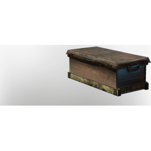 | [Conifer Crate](../items/buildtools/conifer-crate-2537359689.md) | ⚪ Common | - | 20 |
| 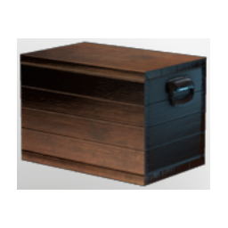 | [Conifer Crate](../items/buildtools/conifer-crate-3904030989.md) | ⚪ Common | - | 20 |
|  | [Conifer Crate](../items/buildtools/conifer-crate-553841242.md) | ⚪ Common | - | 20 |
|  | [Cooking Station](../items/buildtools/cooking-station-3881781700.md) | 🔵 Rare | - | 1 |
|  | [Copper Block](../items/buildtools/copper-block-1619485296.md) | ⚪ Common | - | 5000 |
|  | [Copper Bowl](../items/buildtools/copper-bowl-555173681.md) | ⚪ Common | - | 50 |
|  | [Copper Cup](../items/buildtools/copper-cup-130322938.md) | ⚪ Common | - | 50 |
|  | [Copper Door](../items/buildtools/copper-door-3608731525.md) | ⚪ Common | - | 50 |
|  | [Copper Fence](../items/buildtools/copper-fence-1055652774.md) | ⚪ Common | - | 50 |
|  | [Copper Jug](../items/buildtools/copper-jug-3860676568.md) | ⚪ Common | - | 50 |
|  | [Copper Pickaxe](../items/buildtools/copper-pickaxe-2671192505.md) | 🟢 Uncommon | 10 | 1 |
|  | [Copper Platter](../items/buildtools/copper-platter-815801972.md) | ⚪ Common | - | 50 |
|  | [Coppern Double Door](../items/buildtools/coppern-double-door-1595396826.md) | ⚪ Common | - | 50 |
|  | [Corn Seedling](../items/buildtools/corn-seedling-3660770821.md) | ⚪ Common | - | 100 |
|  | [Cowlick Wig Head](../items/buildtools/cowlick-wig-head-1641258379.md) | 🔵 Rare | - | 5 |
|  | [Critter Plush](../items/buildtools/critter-plush-961402268.md) | ⚪ Common | - | 50 |
|  | [Crucible](../items/buildtools/crucible-4111981896.md) | 🔵 Rare | - | 1 |
|  | [Crude Matress](../items/buildtools/crude-matress-3158197356.md) | ⚪ Common | - | 50 |
|  | [Crude Wooden Chair](../items/buildtools/crude-wooden-chair-2599653665.md) | ⚪ Common | - | 50 |
|  | [Crude Wooden Door](../items/buildtools/crude-wooden-door-2917848991.md) | ⚪ Common | - | 50 |
|  | [Crude Wooden Double Door](../items/buildtools/crude-wooden-double-door-3037001483.md) | ⚪ Common | - | 50 |
|  | [Crude Wooden Fence I](../items/buildtools/crude-wooden-fence-i-1379024580.md) | ⚪ Common | - | 50 |
|  | [Crude Wooden Fence II](../items/buildtools/crude-wooden-fence-ii-1056373483.md) | ⚪ Common | - | 50 |
|  | [Crude Wooden Fence III](../items/buildtools/crude-wooden-fence-iii-130991675.md) | ⚪ Common | - | 50 |
|  | [Crude Wooden Fence IV](../items/buildtools/crude-wooden-fence-iv-1216399513.md) | ⚪ Common | - | 50 |
|  | [Crude Wooden Gate I](../items/buildtools/crude-wooden-gate-i-3215316404.md) | ⚪ Common | - | 50 |
|  | [Crude Wooden Gate II](../items/buildtools/crude-wooden-gate-ii-72695000.md) | ⚪ Common | - | 50 |
|  | [Crystal Bowl](../items/buildtools/crystal-bowl-1444307995.md) | ⚪ Common | - | 50 |
|  | [Crystal Cup](../items/buildtools/crystal-cup-4020741429.md) | ⚪ Common | - | 50 |
|  | [Crystal Jug](../items/buildtools/crystal-jug-977816684.md) | ⚪ Common | - | 50 |
|  | [Crystal Platter](../items/buildtools/crystal-platter-3225687185.md) | ⚪ Common | - | 50 |
|  | [Cultivation Rack](../items/buildtools/cultivation-rack-2698582898.md) | ⚪ Common | - | 20 |
|  | [Cursed Fishing Rod](../items/buildtools/cursed-fishing-rod-1815671523.md) | 🟢 Uncommon | - | 1 |
|  | [Cyan Decorative Box](../items/buildtools/cyan-decorative-box-874980262.md) | ⚪ Common | - | 50 |
|  | [Cylindrical Pillow](../items/buildtools/cylindrical-pillow-1564736216.md) | ⚪ Common | - | 50 |
|  | [Cylindrical Pillow](../items/buildtools/cylindrical-pillow-3063700121.md) | ⚪ Common | - | 50 |
|  | [Date Palm Seedling](../items/buildtools/date-palm-seedling-2703731966.md) | ⚪ Common | - | 100 |
|  | [Daylily Flower Pot](../items/buildtools/daylily-flower-pot-3331736531.md) | ⚪ Common | - | 50 |
|  | [Daylily Seedling](../items/buildtools/daylily-seedling-1291967765.md) | ⚪ Common | - | 100 |
|  | [Dead Wood Block](../items/buildtools/dead-wood-block-2581939916.md) | ⚪ Common | - | 5000 |
|  | [Decorative Bells I](../items/buildtools/decorative-bells-i-1244709120.md) | ⚪ Common | - | 50 |
|  | [Decorative Bells II](../items/buildtools/decorative-bells-ii-2945317938.md) | ⚪ Common | - | 50 |
|  | [Decorative Bells III](../items/buildtools/decorative-bells-iii-4097150814.md) | ⚪ Common | - | 50 |
|  | [Decorative Butter Churn](../items/buildtools/decorative-butter-churn-3218270728.md) | ⚪ Common | - | 20 |
|  | [Decorative Oven I](../items/buildtools/decorative-oven-i-2004762545.md) | ⚪ Common | - | 50 |
|  | [Decorative Oven II](../items/buildtools/decorative-oven-ii-3069381157.md) | ⚪ Common | - | 50 |
|  | [Decorative Oven III](../items/buildtools/decorative-oven-iii-3005030010.md) | ⚪ Common | - | 50 |
|  | [Decorative Skull I](../items/buildtools/decorative-skull-i-662663034.md) | ⚪ Common | - | 50 |
|  | [Decorative Skull II](../items/buildtools/decorative-skull-ii-1977753491.md) | ⚪ Common | - | 50 |
|  | [Decorative Skull III](../items/buildtools/decorative-skull-iii-2273496401.md) | ⚪ Common | - | 50 |
|  | [Deluxe Edition Items](../items/buildtools/deluxe-edition-items-3432840465.md) | ⚪ Common | - | 1 |
|  | [Desert Bird](../items/buildtools/desert-bird-4219894424.md) | ⚪ Common | - | 1 |
|  | [Desert City Wall](../items/buildtools/desert-city-wall-3178080467.md) | ⚪ Common | - | 5000 |
|  | [Desert Flower Seedling](../items/buildtools/desert-flower-seedling-2024314426.md) | ⚪ Common | - | 100 |
|  | [Desert Temple Block](../items/buildtools/desert-temple-block-2875012578.md) | ⚪ Common | - | 5000 |
|  | [Devil's Claw Seedling](../items/buildtools/devil-s-claw-seedling-1898312963.md) | ⚪ Common | - | 100 |
|  | [Diamond Wall Emblem I](../items/buildtools/diamond-wall-emblem-i-2918524342.md) | ⚪ Common | - | 50 |
|  | [Diamond Wall Emblem II](../items/buildtools/diamond-wall-emblem-ii-2980093307.md) | ⚪ Common | - | 50 |
|  | [Direction Sign](../items/buildtools/direction-sign-877616264.md) | ⚪ Common | - | 20 |
|  | [Distillery Pot 01](../items/buildtools/distillery-pot-01-3108885274.md) | ⚪ Common | - | 20 |
|  | [Distillery Pot 02](../items/buildtools/distillery-pot-02-1118012982.md) | ⚪ Common | - | 20 |
|  | [Distillery Pot 03](../items/buildtools/distillery-pot-03-2430442830.md) | ⚪ Common | - | 20 |
|  | [Distillery Pot 04](../items/buildtools/distillery-pot-04-2149993733.md) | ⚪ Common | - | 20 |
|  | [Distillery Pot 05](../items/buildtools/distillery-pot-05-2510818020.md) | ⚪ Common | - | 20 |
|  | [Distillery Pot 06](../items/buildtools/distillery-pot-06-694060940.md) | ⚪ Common | - | 20 |
|  | [Distillery Pot 07](../items/buildtools/distillery-pot-07-2649752781.md) | ⚪ Common | - | 20 |
|  | [Distillery Pot 08](../items/buildtools/distillery-pot-08-2864379507.md) | ⚪ Common | - | 20 |
|  | [DLC SUpporter Mage Banner Standing](../items/buildtools/dlc-supporter-mage-banner-standing-1740766717.md) | ⚪ Common | - | 20 |
|  | [DLC SUpporter Mage Banner Wall](../items/buildtools/dlc-supporter-mage-banner-wall-2672915212.md) | ⚪ Common | - | 20 |
|  | [DLC Supporter Pack Mage Throne](../items/buildtools/dlc-supporter-pack-mage-throne-4130138520.md) | ⚪ Common | - | 50 |
|  | [DLC Supporter Pack Ranger Throne](../items/buildtools/dlc-supporter-pack-ranger-throne-508336910.md) | ⚪ Common | - | 50 |
|  | [DLC Supporter Pack Warrior Throne](../items/buildtools/dlc-supporter-pack-warrior-throne-2451952640.md) | ⚪ Common | - | 50 |
|  | [DLC SUpporter Ranger Banner Standing](../items/buildtools/dlc-supporter-ranger-banner-standing-1405702064.md) | ⚪ Common | - | 20 |
|  | [DLC SUpporter Ranger Banner Wall](../items/buildtools/dlc-supporter-ranger-banner-wall-1823962788.md) | ⚪ Common | - | 20 |
|  | [DLC SUpporter Warrior Banner Standing](../items/buildtools/dlc-supporter-warrior-banner-standing-2406775744.md) | ⚪ Common | - | 20 |
|  | [DLC SUpporter Warrior Banner Wall](../items/buildtools/dlc-supporter-warrior-banner-wall-4076482688.md) | ⚪ Common | - | 20 |
|  | [Dog Bowl](../items/buildtools/dog-bowl-1075741759.md) | ⚪ Common | - | 50 |
|  | [Dog Pillow](../items/buildtools/dog-pillow-885937007.md) | ⚪ Common | - | 50 |
|  | [Door chinese New Year](../items/buildtools/door-chinese-new-year-2718386496.md) | ⚪ Common | - | 50 |
|  | [Door Talltree](../items/buildtools/door-talltree-1453779109.md) | ⚪ Common | - | 50 |
|  | [Drak Relief Showcase](../items/buildtools/drak-relief-showcase-1095180478.md) | ⚪ Common | - | 20 |
|  | [Drak Stone Totem I](../items/buildtools/drak-stone-totem-i-3340302763.md) | ⚪ Common | - | 20 |
|  | [Drak Stone Totem I](../items/buildtools/drak-stone-totem-i-674281730.md) | ⚪ Common | - | 20 |
|  | [Drak Stone Totem II](../items/buildtools/drak-stone-totem-ii-1734846827.md) | ⚪ Common | - | 20 |
|  | [Drak Stone Totem III](../items/buildtools/drak-stone-totem-iii-174600513.md) | ⚪ Common | - | 20 |
|  | [Drak Stone Totem IV](../items/buildtools/drak-stone-totem-iv-3045071835.md) | ⚪ Common | - | 20 |
|  | [Drak Stone Totem V](../items/buildtools/drak-stone-totem-v-778201792.md) | ⚪ Common | - | 20 |
|  | [Drak Temple Vase I](../items/buildtools/drak-temple-vase-i-1639638331.md) | ⚪ Common | - | 50 |
|  | [Drak Temple Vase II](../items/buildtools/drak-temple-vase-ii-2164330756.md) | ⚪ Common | - | 50 |
|  | [Drak Temple Vase III](../items/buildtools/drak-temple-vase-iii-4252559857.md) | ⚪ Common | - | 50 |
|  | [Drak Temple Vase IV](../items/buildtools/drak-temple-vase-iv-530828281.md) | ⚪ Common | - | 50 |
|  | [Drak Temple Vase V](../items/buildtools/drak-temple-vase-v-662985240.md) | ⚪ Common | - | 50 |
|  | [Drak Temple Vase VI](../items/buildtools/drak-temple-vase-vi-3712260646.md) | ⚪ Common | - | 50 |
|  | [Drak Temple Vase VII](../items/buildtools/drak-temple-vase-vii-3198510897.md) | ⚪ Common | - | 50 |
|  | [Drak Trophy Wall Head - Twitch Drop](../items/buildtools/drak-trophy-wall-head-twitch-drop-2469035941.md) | 🟠 Legendary | - | 10 |
|  | [Drak Wood Totem I](../items/buildtools/drak-wood-totem-i-3456819812.md) | ⚪ Common | - | 20 |
|  | [Drak Wood Totem II](../items/buildtools/drak-wood-totem-ii-2892618521.md) | ⚪ Common | - | 20 |
|  | [Drak Wood Totem III](../items/buildtools/drak-wood-totem-iii-1874208947.md) | ⚪ Common | - | 20 |
|  | [Drak Wood Totem IV](../items/buildtools/drak-wood-totem-iv-2468542740.md) | ⚪ Common | - | 20 |
|  | [Drak Wood Totem V](../items/buildtools/drak-wood-totem-v-1898842260.md) | ⚪ Common | - | 20 |
|  | [Drum](../items/buildtools/drum-2247014936.md) | ⚪ Common | - | 1 |
|  | [Drying Rack](../items/buildtools/drying-rack-3513149511.md) | 🔵 Rare | - | 1 |
|  | [Early Access Reward Badge](../items/buildtools/early-access-reward-badge-1705873383.md) | 🔵 Rare | - | 20 |
|  | [Early Access Reward Book](../items/buildtools/early-access-reward-book-543168017.md) | 🔵 Rare | - | 20 |
|  | [EarlyAccess Reward Items](../items/buildtools/earlyaccess-reward-items-1916039100.md) | ⚪ Common | - | 1 |
|  | [Elevated Huge Coffin](../items/buildtools/elevated-huge-coffin-1584621189.md) | ⚪ Common | - | 20 |
|  | [Embervale Miniature Showcase](../items/buildtools/embervale-miniature-showcase-1764672566.md) | ⚪ Common | - | 20 |
|  | [Emily](../items/buildtools/emily-1004393385.md) | 🔵 Rare | - | 1 |
|  | [Empty Cymbidum Pot](../items/buildtools/empty-cymbidum-pot-2125538426.md) | ⚪ Common | - | 50 |
|  | [Empty Cymbidum Pot](../items/buildtools/empty-cymbidum-pot-4135259126.md) | ⚪ Common | - | 50 |
|  | [Empty Farmbed](../items/buildtools/empty-farmbed-1392367211.md) | 🔵 Rare | - | 10 |
|  | [Empty Farmbed](../items/buildtools/empty-farmbed-2425261321.md) | 🔵 Rare | - | 10 |
|  | [Empty Farmbed](../items/buildtools/empty-farmbed-3310867211.md) | 🔵 Rare | - | 10 |
|  | [Empty Farmbed](../items/buildtools/empty-farmbed-3916554796.md) | 🔵 Rare | - | 10 |
|  | [Empty Farmbed](../items/buildtools/empty-farmbed-604994553.md) | 🔵 Rare | - | 10 |
|  | [Empty Fern Pot](../items/buildtools/empty-fern-pot-3224973803.md) | ⚪ Common | - | 50 |
|  | [Empty Flower Pot I](../items/buildtools/empty-flower-pot-i-1515343684.md) | ⚪ Common | - | 50 |
|  | [Empty Flower Pot II](../items/buildtools/empty-flower-pot-ii-624884086.md) | ⚪ Common | - | 50 |
|  | [Empty Flower Pot III](../items/buildtools/empty-flower-pot-iii-1882339175.md) | ⚪ Common | - | 50 |
|  | [Empty Flower Pot IV](../items/buildtools/empty-flower-pot-iv-99730651.md) | ⚪ Common | - | 50 |
|  | [Empty Flower Pot V](../items/buildtools/empty-flower-pot-v-2996817370.md) | ⚪ Common | - | 50 |
|  | [Empty Flower Pot VI](../items/buildtools/empty-flower-pot-vi-1642368164.md) | ⚪ Common | - | 50 |
|  | [Empty Flower Pot VII](../items/buildtools/empty-flower-pot-vii-101823326.md) | ⚪ Common | - | 50 |
|  | [Empty Lily Pot](../items/buildtools/empty-lily-pot-2328440963.md) | ⚪ Common | - | 50 |
|  | [Empty Lily Pot](../items/buildtools/empty-lily-pot-3534930699.md) | ⚪ Common | - | 50 |
|  | [Empty Lily Pot](../items/buildtools/empty-lily-pot-3593229714.md) | ⚪ Common | - | 50 |
|  | [Enormous Magic Chest](../items/buildtools/enormous-magic-chest-30818586.md) | ⚪ Common | - | 1 |
|  | [Epic Dragon Brazier](../items/buildtools/epic-dragon-brazier-3395224471.md) | ⚪ Common | - | 50 |
|  | [Excellent Fishing Rod](../items/buildtools/excellent-fishing-rod-2943277884.md) | 🟣 Epic | - | 1 |
|  | [Exceptional Drum](../items/buildtools/exceptional-drum-1325385401.md) | 🟣 Epic | - | 1 |
|  | [Exceptional Flute](../items/buildtools/exceptional-flute-4077419426.md) | 🟣 Epic | - | 1 |
|  | [Exceptional Harp](../items/buildtools/exceptional-harp-945847733.md) | 🟣 Epic | - | 1 |
|  | [Exceptional Lute](../items/buildtools/exceptional-lute-3302809729.md) | 🟣 Epic | - | 1 |
|  | [Exeptional Hang-Drum](../items/buildtools/exeptional-hang-drum-697485895.md) | 🟣 Epic | - | 1 |
|  | [Explosive Barrel](../items/buildtools/explosive-barrel-3462191401.md) | ⚪ Common | - | 200 |
|  | [Fae Deer Pillow](../items/buildtools/fae-deer-pillow-1936163292.md) | ⚪ Common | - | 50 |
|  | [Fae Deer Pillow](../items/buildtools/fae-deer-pillow-3507499853.md) | ⚪ Common | - | 50 |
|  | [Fake Ancient Wall Secret](../items/buildtools/fake-ancient-wall-secret-2172312678.md) | 🔵 Rare | - | 50 |
|  | [Fake Ancient Wall Secret](../items/buildtools/fake-ancient-wall-secret-543479720.md) | 🔵 Rare | - | 50 |
|  | [Fake Basement Wall Secret](../items/buildtools/fake-basement-wall-secret-664097033.md) | 🔵 Rare | - | 50 |
|  | [Fake Castle Wall Secret](../items/buildtools/fake-castle-wall-secret-3133014614.md) | 🔵 Rare | - | 50 |
|  | [Fake Secret Stairs](../items/buildtools/fake-secret-stairs-1305097602.md) | 🔵 Rare | - | 50 |
|  | [Fake Stone Floor Secret](../items/buildtools/fake-stone-floor-secret-1047383927.md) | 🔵 Rare | - | 50 |
|  | [Fake Stone Wall Secret](../items/buildtools/fake-stone-wall-secret-1276236959.md) | 🔵 Rare | - | 50 |
|  | [Fake Stone Wall Secret TallTree](../items/buildtools/fake-stone-wall-secret-talltree-2440933032.md) | 🔵 Rare | - | 50 |
|  | [Fake Wood Wall Secret](../items/buildtools/fake-wood-wall-secret-2809296280.md) | 🔵 Rare | - | 50 |
|  | [Fake Wooden Floor Secret](../items/buildtools/fake-wooden-floor-secret-1042118922.md) | 🔵 Rare | - | 50 |
|  | [Fallen Crypt Block](../items/buildtools/fallen-crypt-block-2041116756.md) | ⚪ Common | - | 5000 |
|  | [Falsk Medium](../items/buildtools/falsk-medium-2020294526.md) | ⚪ Common | - | 50 |
|  | [Fancy Stone Block](../items/buildtools/fancy-stone-block-3627519922.md) | ⚪ Common | - | 5000 |
|  | [Fell Critter Queen Trophy](../items/buildtools/fell-critter-queen-trophy-421729762.md) | 🔵 Rare | - | 10 |
|  | [Fence Hollow Halls](../items/buildtools/fence-hollow-halls-3983205690.md) | ⚪ Common | - | 50 |
|  | [Fence Hollow Halls Big](../items/buildtools/fence-hollow-halls-big-1799390834.md) | ⚪ Common | - | 50 |
|  | [Fenrig Mills, Jr.](../items/buildtools/fenrig-mills-jr-1209217157.md) | 🔵 Rare | - | 1 |
|  | [Fern Pot](../items/buildtools/fern-pot-1228884892.md) | ⚪ Common | - | 50 |
|  | [Fern Pot](../items/buildtools/fern-pot-1665119413.md) | ⚪ Common | - | 50 |
|  | [Fern Pot](../items/buildtools/fern-pot-2019603203.md) | ⚪ Common | - | 50 |
|  | [Fern Pot](../items/buildtools/fern-pot-673405648.md) | ⚪ Common | - | 50 |
|  | [Fine Drum](../items/buildtools/fine-drum-69172143.md) | 🔵 Rare | - | 1 |
|  | [Fine Flute](../items/buildtools/fine-flute-1353321355.md) | 🔵 Rare | - | 1 |
|  | [Fine Hang-Drum](../items/buildtools/fine-hang-drum-23035970.md) | 🔵 Rare | - | 1 |
|  | [Fine Hardwood Door](../items/buildtools/fine-hardwood-door-517818801.md) | ⚪ Common | - | 50 |
|  | [Fine Hardwood Double Door](../items/buildtools/fine-hardwood-double-door-337744460.md) | ⚪ Common | - | 50 |
|  | [Fine Lute](../items/buildtools/fine-lute-1094517700.md) | 🔵 Rare | - | 1 |
|  | [Fine Stone Fence](../items/buildtools/fine-stone-fence-2049249086.md) | ⚪ Common | - | 20 |
|  | [Fine Stone Fence](../items/buildtools/fine-stone-fence-2278407208.md) | ⚪ Common | - | 50 |
|  | [Fine Stone Fence Pole](../items/buildtools/fine-stone-fence-pole-2841036941.md) | ⚪ Common | - | 50 |
|  | [Fine Wooden Fence](../items/buildtools/fine-wooden-fence-3166374248.md) | ⚪ Common | - | 50 |
|  | [Fine Wooden Fence](../items/buildtools/fine-wooden-fence-3307829786.md) | ⚪ Common | - | 50 |
|  | [Fine Wooden Fence](../items/buildtools/fine-wooden-fence-703273030.md) | ⚪ Common | - | 20 |
|  | [Fine Wooden Fence Pole](../items/buildtools/fine-wooden-fence-pole-3618025467.md) | ⚪ Common | - | 50 |
|  | [Fine Wooden Fence Pole](../items/buildtools/fine-wooden-fence-pole-4080829941.md) | ⚪ Common | - | 50 |
|  | [Fine Wooden Handrail](../items/buildtools/fine-wooden-handrail-760996732.md) | ⚪ Common | - | 50 |
|  | [Fire Bowl](../items/buildtools/fire-bowl-3186070284.md) | ⚪ Common | - | 50 |
|  | [Fired Bricks Block](../items/buildtools/fired-bricks-block-3775747292.md) | ⚪ Common | - | 5000 |
|  | [Firefly Basket](../items/buildtools/firefly-basket-834043165.md) | ⚪ Common | - | 50 |
|  | [Firefly Chandelier Basket](../items/buildtools/firefly-chandelier-basket-4044216073.md) | ⚪ Common | - | 50 |
|  | [Firefly Standing Basket](../items/buildtools/firefly-standing-basket-245164403.md) | ⚪ Common | - | 50 |
|  | [Firefly Wall Basket](../items/buildtools/firefly-wall-basket-202378255.md) | ⚪ Common | - | 50 |
|  | [Fish Cage](../items/buildtools/fish-cage-2692198359.md) | ⚪ Common | - | 50 |
|  | [Fish Drying Rack](../items/buildtools/fish-drying-rack-4264389715.md) | ⚪ Common | - | 50 |
|  | [Fish Showcase](../items/buildtools/fish-showcase-2813422596.md) | ⚪ Common | - | 20 |
|  | [Flag Pole I](../items/buildtools/flag-pole-i-32887851.md) | ⚪ Common | - | 20 |
|  | [Flag Pole II](../items/buildtools/flag-pole-ii-1596806993.md) | ⚪ Common | - | 20 |
|  | [Flag Pole III](../items/buildtools/flag-pole-iii-383915057.md) | ⚪ Common | - | 20 |
|  | [Flag Pole IV](../items/buildtools/flag-pole-iv-3929204963.md) | ⚪ Common | - | 20 |
|  | [Flag Pole V](../items/buildtools/flag-pole-v-2344368210.md) | ⚪ Common | - | 20 |
|  | [Flag Pole VI](../items/buildtools/flag-pole-vi-3078925869.md) | ⚪ Common | - | 20 |
|  | [Flame Altar](../items/buildtools/flame-altar-3954785428.md) | ⚪ Common | - | 1 |
|  | [Flask Small](../items/buildtools/flask-small-1668858460.md) | ⚪ Common | - | 50 |
|  | [Flax Flower Pot](../items/buildtools/flax-flower-pot-307918428.md) | ⚪ Common | - | 50 |
|  | [Flax Seedling](../items/buildtools/flax-seedling-34487402.md) | ⚪ Common | - | 100 |
|  | [Flightless Redtail Pillow](../items/buildtools/flightless-redtail-pillow-1568297956.md) | ⚪ Common | - | 50 |
|  | [Flightless Redtail Pillow](../items/buildtools/flightless-redtail-pillow-2236552740.md) | ⚪ Common | - | 50 |
|  | [Floating](../items/buildtools/floating-2979787678.md) | 🟣 Epic | - | 20 |
|  | [Flower Wreath](../items/buildtools/flower-wreath-439541859.md) | ⚪ Common | - | 20 |
|  | [Flower Wreath](../items/buildtools/flower-wreath-627624860.md) | ⚪ Common | - | 20 |
|  | [Flute](../items/buildtools/flute-2971345775.md) | ⚪ Common | - | 1 |
|  | [Food Bunny Feeding](../items/buildtools/food-bunny-feeding-1674254183.md) | ⚪ Common | - | 200 |
|  | [Food Cat Feeeding](../items/buildtools/food-cat-feeeding-1175242603.md) | ⚪ Common | - | 200 |
|  | [Food Catdeer Feeding](../items/buildtools/food-catdeer-feeding-2417128668.md) | ⚪ Common | - | 200 |
|  | [Food Dog Feeding](../items/buildtools/food-dog-feeding-1522120746.md) | ⚪ Common | - | 200 |
|  | [Food Goat Feeding](../items/buildtools/food-goat-feeding-206667189.md) | ⚪ Common | - | 200 |
|  | [Food Sanddigger Feeding](../items/buildtools/food-sanddigger-feeding-2013116716.md) | ⚪ Common | - | 200 |
|  | [Food Turkey Feeding](../items/buildtools/food-turkey-feeding-2553328095.md) | ⚪ Common | - | 200 |
|  | [Food Yak Feeding](../items/buildtools/food-yak-feeding-3044969758.md) | ⚪ Common | - | 200 |
|  | [Forge](../items/buildtools/forge-770717366.md) | 🔵 Rare | - | 1 |
|  | [Fur Rug](../items/buildtools/fur-rug-3910511825.md) | ⚪ Common | - | 50 |
|  | [Furry straw mat](../items/buildtools/furry-straw-mat-1318773899.md) | ⚪ Common | - | 50 |
|  | [Galen Yager](../items/buildtools/galen-yager-3991532476.md) | 🔵 Rare | - | 1 |
|  | [Garden Gnome](../items/buildtools/garden-gnome-1622296983.md) | ⚪ Common | - | 50 |
|  | [Gentian Flower Pot](../items/buildtools/gentian-flower-pot-965243086.md) | ⚪ Common | - | 50 |
|  | [Giant hollow Halls Banner](../items/buildtools/giant-hollow-halls-banner-3200238404.md) | ⚪ Common | - | 20 |
|  | [Giant Telescope](../items/buildtools/giant-telescope-3716077081.md) | ⚪ Common | - | 50 |
|  | [Giant Telescope Base](../items/buildtools/giant-telescope-base-1390027713.md) | ⚪ Common | - | 50 |
|  | [Gift Of Violence](../items/buildtools/gift-of-violence-3672233769.md) | 🟣 Epic | - | 20 |
|  | [Ginger Flower Pot](../items/buildtools/ginger-flower-pot-3803006190.md) | ⚪ Common | - | 50 |
|  | [Ginger Seedling](../items/buildtools/ginger-seedling-2601152870.md) | ⚪ Common | - | 100 |
|  | [Gleam Root Flower Pot](../items/buildtools/gleam-root-flower-pot-2027224453.md) | ⚪ Common | - | 50 |
|  | [Glimmer Gentian Flower Pot](../items/buildtools/glimmer-gentian-flower-pot-3758178692.md) | ⚪ Common | - | 50 |
|  | [Globe](../items/buildtools/globe-1589845330.md) | ⚪ Common | - | 50 |
|  | [Globe TwitchDrop](../items/buildtools/globe-twitchdrop-394551254.md) | ⚪ Common | - | 50 |

[← All categories](../README.md) · page [1](buildtools.md) · **2** · [3](buildtools-3.md) · [4](buildtools-4.md) · [5](buildtools-5.md) · [6](buildtools-6.md)
