# Building

1556 items · page [1](buildtools.md) · [2](buildtools-2.md) · [3](buildtools-3.md) · **4** · [5](buildtools-5.md) · [6](buildtools-6.md)

| Icon | Name | Rarity | Level | Stack |
|:---:|---|---|:---:|:---:|
| 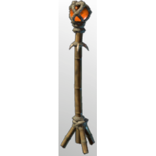 | [Orange Floor Light I](../items/buildtools/orange-floor-light-i-417177465.md) | ⚪ Common | - | 50 |
| 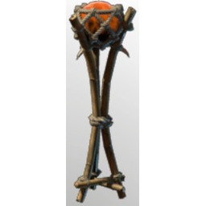 | [Orange Floor Light II](../items/buildtools/orange-floor-light-ii-4083221254.md) | ⚪ Common | - | 50 |
| 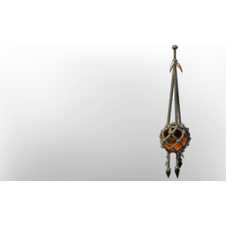 | [Orange Pendant Light I](../items/buildtools/orange-pendant-light-i-3057351533.md) | ⚪ Common | - | 50 |
| 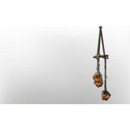 | [Orange Pendant Light II](../items/buildtools/orange-pendant-light-ii-193218758.md) | ⚪ Common | - | 50 |
| 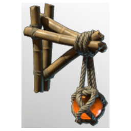 | [Orange Wall Light I](../items/buildtools/orange-wall-light-i-853154934.md) | ⚪ Common | - | 50 |
| 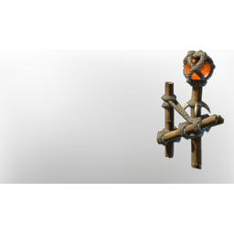 | [Orange Wall Light II](../items/buildtools/orange-wall-light-ii-3679359640.md) | ⚪ Common | - | 50 |
| 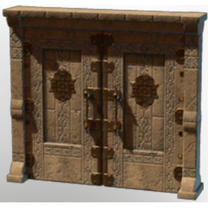 | [Ornamented Stone Double Door](../items/buildtools/ornamented-stone-double-door-693578082.md) | ⚪ Common | - | 50 |
| 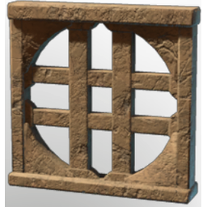 | [Ornamented Stone Window Frame](../items/buildtools/ornamented-stone-window-frame-210614111.md) | ⚪ Common | - | 50 |
| 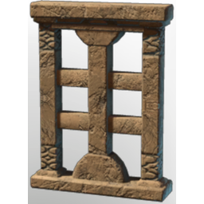 | [Ornamented Stone Window Frame](../items/buildtools/ornamented-stone-window-frame-3701510493.md) | ⚪ Common | - | 50 |
| 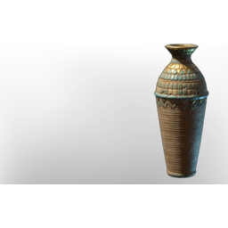 | [Ornamented Vase I](../items/buildtools/ornamented-vase-i-1310569034.md) | ⚪ Common | - | 50 |
| 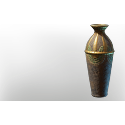 | [Ornamented Vase II](../items/buildtools/ornamented-vase-ii-155892145.md) | ⚪ Common | - | 50 |
| 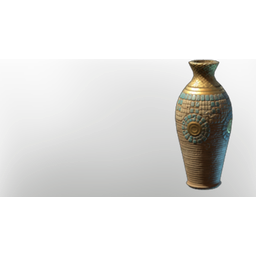 | [Ornamented Vase III](../items/buildtools/ornamented-vase-iii-2822831184.md) | ⚪ Common | - | 50 |
|  | [Ornamented Vase IV](../items/buildtools/ornamented-vase-iv-3614671585.md) | ⚪ Common | - | 50 |
| 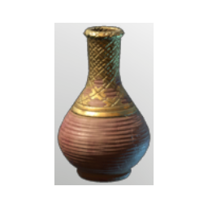 | [Ornamented Vase V](../items/buildtools/ornamented-vase-v-1881399211.md) | ⚪ Common | - | 50 |
| 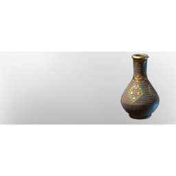 | [Ornamented Vase VI](../items/buildtools/ornamented-vase-vi-1294494262.md) | ⚪ Common | - | 50 |
| 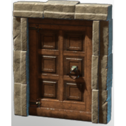 | [Ornamented Wooden Door](../items/buildtools/ornamented-wooden-door-3012628405.md) | ⚪ Common | - | 50 |
| 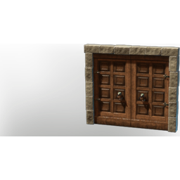 | [Ornamented Wooden Double Door](../items/buildtools/ornamented-wooden-double-door-3688853714.md) | ⚪ Common | - | 50 |
|  | [Ornamented Wooden Shelf](../items/buildtools/ornamented-wooden-shelf-3805156322.md) | ⚪ Common | - | 50 |
|  | [Ornamented Wooden Window Frame](../items/buildtools/ornamented-wooden-window-frame-1320797608.md) | ⚪ Common | - | 50 |
| 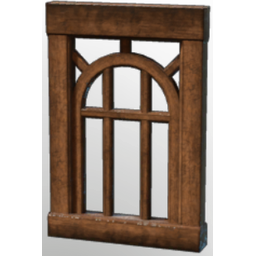 | [Ornamented Wooden Window Frame](../items/buildtools/ornamented-wooden-window-frame-2651036233.md) | ⚪ Common | - | 50 |
|  | [Ornate Hardwood Block](../items/buildtools/ornate-hardwood-block-641139736.md) | ⚪ Common | - | 5000 |
| 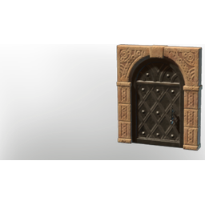 | [Ornate Iron Door](../items/buildtools/ornate-iron-door-437915741.md) | ⚪ Common | - | 50 |
|  | [Ornate Iron Double Door](../items/buildtools/ornate-iron-double-door-2544552928.md) | ⚪ Common | - | 50 |
| 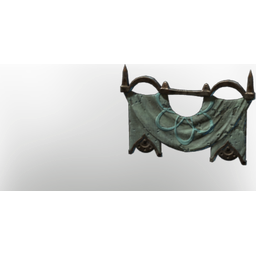 | [Ornate Wall Banner](../items/buildtools/ornate-wall-banner-1539285358.md) | ⚪ Common | - | 20 |
|  | [Oscar Godwin](../items/buildtools/oscar-godwin-2801667479.md) | 🔵 Rare | - | 1 |
|  | [Oswald](../items/buildtools/oswald-786532879.md) | 🔵 Rare | - | 1 |
| 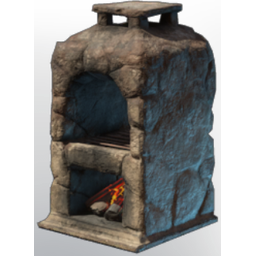 | [Oven](../items/buildtools/oven-3397817290.md) | 🔵 Rare | - | 1 |
| 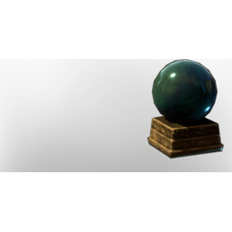 | [Palanthir](../items/buildtools/palanthir-3682420039.md) | ⚪ Common | - | 50 |
|  | [Palm Leaf Basket](../items/buildtools/palm-leaf-basket-1108421963.md) | ⚪ Common | - | 20 |
|  | [Palm Leaf Basket](../items/buildtools/palm-leaf-basket-4179466778.md) | ⚪ Common | - | 20 |
|  | [Palm Leaf Basket](../items/buildtools/palm-leaf-basket-4206640908.md) | ⚪ Common | - | 20 |
| 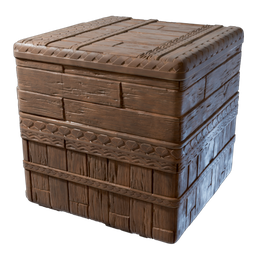 | [Palm Wood Block](../items/buildtools/palm-wood-block-2825372463.md) | ⚪ Common | - | 5000 |
| 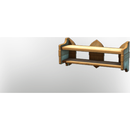 | [Palmwood Shelf](../items/buildtools/palmwood-shelf-736877897.md) | ⚪ Common | - | 50 |
| 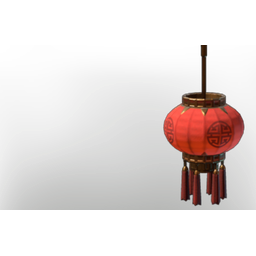 | [Paper Lantern I](../items/buildtools/paper-lantern-i-1057970078.md) | ⚪ Common | - | 50 |
| 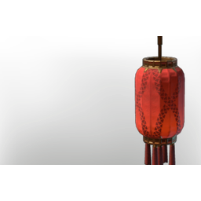 | [Paper Lantern II](../items/buildtools/paper-lantern-ii-1987268311.md) | ⚪ Common | - | 50 |
| 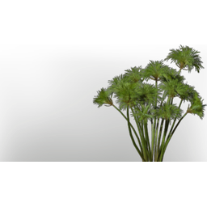 | [Papyrus Seedling](../items/buildtools/papyrus-seedling-506636559.md) | ⚪ Common | - | 100 |
| 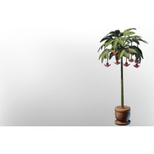 | [Passionflower Flower Pot](../items/buildtools/passionflower-flower-pot-3127704929.md) | ⚪ Common | - | 50 |
|  | [Pendant Ceiling Lantern](../items/buildtools/pendant-ceiling-lantern-2100892316.md) | ⚪ Common | - | 50 |
| 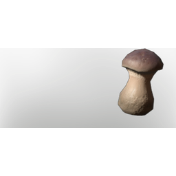 | [Penny Bun Seedling](../items/buildtools/penny-bun-seedling-751481953.md) | ⚪ Common | - | 100 |
| 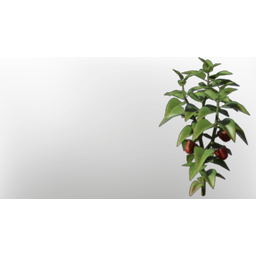 | [Pepper Seedling](../items/buildtools/pepper-seedling-2330783516.md) | ⚪ Common | - | 100 |
| 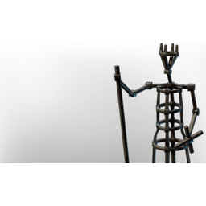 | [PikeMeadStatue Showcase](../items/buildtools/pikemeadstatue-showcase-171960142.md) | ⚪ Common | - | 20 |
|  | [PikeMeadStatue Showcase](../items/buildtools/pikemeadstatue-showcase-2102661805.md) | ⚪ Common | - | 20 |
| 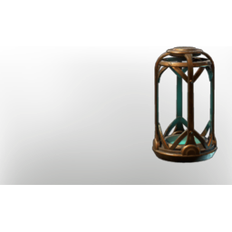 | [PikeMeadStatue Showcase](../items/buildtools/pikemeadstatue-showcase-791796170.md) | ⚪ Common | - | 20 |
| 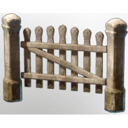 | [Pine Wood Garden Fence Door](../items/buildtools/pine-wood-garden-fence-door-1111884223.md) | ⚪ Common | - | 50 |
| 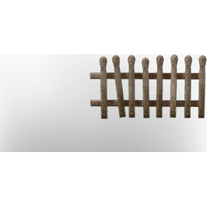 | [Pine Wood Garden Fence I](../items/buildtools/pine-wood-garden-fence-i-842940981.md) | ⚪ Common | - | 50 |
| 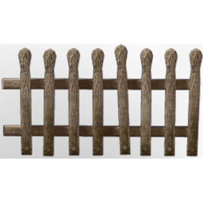 | [Pine Wood Garden Fence II](../items/buildtools/pine-wood-garden-fence-ii-3343616857.md) | ⚪ Common | - | 50 |
| 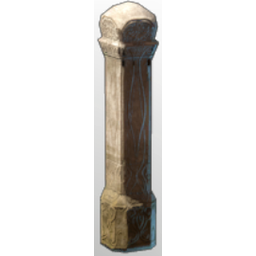 | [Pine Wood Garden Fence Pole](../items/buildtools/pine-wood-garden-fence-pole-1248457047.md) | ⚪ Common | - | 50 |
|  | [Pinewood Door with silver ornaments](../items/buildtools/pinewood-door-with-silver-ornaments-4176703426.md) | ⚪ Common | - | 50 |
|  | [Pinewood Double Door with silver ornaments](../items/buildtools/pinewood-double-door-with-silver-ornaments-1652824178.md) | ⚪ Common | - | 50 |
| 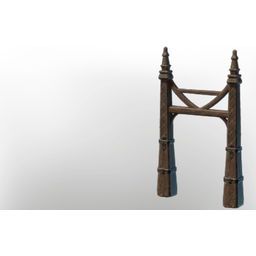 | [Pinewood Fence Gate I](../items/buildtools/pinewood-fence-gate-i-432372158.md) | ⚪ Common | - | 50 |
| 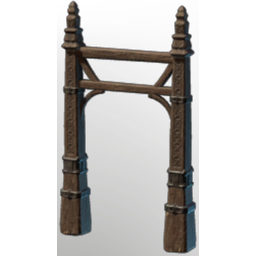 | [Pinewood Fence Gate II](../items/buildtools/pinewood-fence-gate-ii-3886008573.md) | ⚪ Common | - | 50 |
| 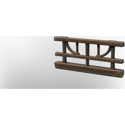 | [Pinewood Fence I](../items/buildtools/pinewood-fence-i-1596758429.md) | ⚪ Common | - | 50 |
| 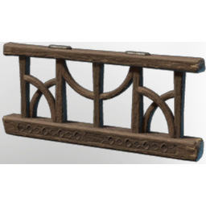 | [Pinewood Fence II](../items/buildtools/pinewood-fence-ii-1797805454.md) | ⚪ Common | - | 50 |
| 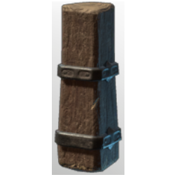 | [Pinewood Fence Pole](../items/buildtools/pinewood-fence-pole-3212731674.md) | ⚪ Common | - | 50 |
| 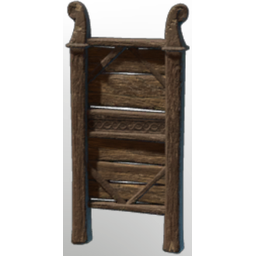 | [Pinewood Room Divider I](../items/buildtools/pinewood-room-divider-i-1560142232.md) | ⚪ Common | - | 50 |
| 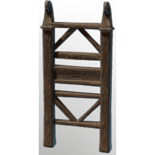 | [Pinewood Room Divider II](../items/buildtools/pinewood-room-divider-ii-2995278025.md) | ⚪ Common | - | 50 |
| 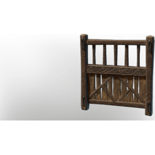 | [Pinewood Room Divider III](../items/buildtools/pinewood-room-divider-iii-1060167728.md) | ⚪ Common | - | 50 |
| 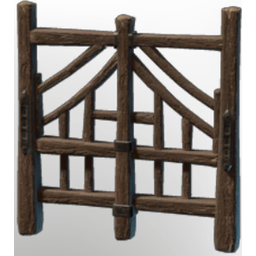 | [Pinewood Room Divider IV](../items/buildtools/pinewood-room-divider-iv-3576088941.md) | ⚪ Common | - | 50 |
|  | [Pink Flower Pot](../items/buildtools/pink-flower-pot-1682046505.md) | ⚪ Common | - | 50 |
|  | [Pink Flower Pot](../items/buildtools/pink-flower-pot-2741207192.md) | ⚪ Common | - | 50 |
|  | [Pink Flower Pot](../items/buildtools/pink-flower-pot-2927706943.md) | ⚪ Common | - | 50 |
|  | [Pink Flower Pot](../items/buildtools/pink-flower-pot-308344880.md) | ⚪ Common | - | 50 |
|  | [Pink Flower Pot](../items/buildtools/pink-flower-pot-4272163256.md) | ⚪ Common | - | 50 |
| 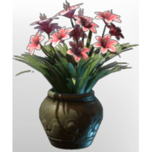 | [Pink Lily Flower Pot](../items/buildtools/pink-lily-flower-pot-3148035436.md) | ⚪ Common | - | 50 |
| 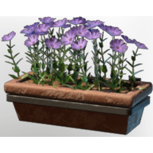 | [Pink Wall Pot](../items/buildtools/pink-wall-pot-1416182802.md) | ⚪ Common | - | 50 |
| 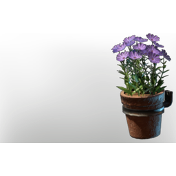 | [Pink Wall Pot](../items/buildtools/pink-wall-pot-533905592.md) | ⚪ Common | - | 50 |
| 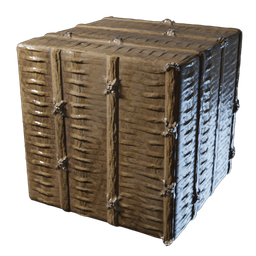 | [Plaited Block](../items/buildtools/plaited-block-2762553617.md) | ⚪ Common | - | 5000 |
| 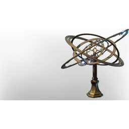 | [Planetarium](../items/buildtools/planetarium-724156552.md) | ⚪ Common | - | 50 |
| 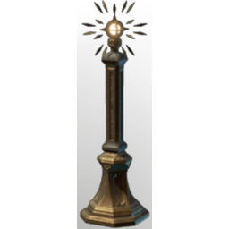 | [Planetarium Showcase/ Orbit](../items/buildtools/planetarium-showcase-orbit-3205476444.md) | ⚪ Common | - | 20 |
|  | [Plant Fibre Roof Block](../items/buildtools/plant-fibre-roof-block-4077117519.md) | ⚪ Common | - | 5000 |
|  | [Player Base Gem Forge](../items/buildtools/player-base-gem-forge-3250908839.md) | ⚪ Common | - | 1 |
|  | [Plough](../items/buildtools/plough-1485009287.md) | ⚪ Common | - | 20 |
|  | [Polished Scrap Brazier](../items/buildtools/polished-scrap-brazier-3457345820.md) | ⚪ Common | - | 50 |
|  | [Pom Pom Jr.](../items/buildtools/pom-pom-jr-536528154.md) | ⚪ Common | - | 1 |
|  | [PreOrder DLC Logo Symbol projector](../items/buildtools/preorder-dlc-logo-symbol-projector-310741113.md) | ⚪ Common | - | 50 |
|  | [PreOrder Reward Items](../items/buildtools/preorder-reward-items-1964397393.md) | ⚪ Common | - | 1 |
|  | [Pressure plate](../items/buildtools/pressure-plate-3590042993.md) | ⚪ Common | - | 50 |
|  | [Prison Fence](../items/buildtools/prison-fence-2452070869.md) | ⚪ Common | - | 50 |
|  | [Prison Fence](../items/buildtools/prison-fence-3434035481.md) | ⚪ Common | - | 50 |
|  | [Prison Fence Corner](../items/buildtools/prison-fence-corner-2605453799.md) | ⚪ Common | - | 50 |
|  | [Prison Fence Gate](../items/buildtools/prison-fence-gate-1994301209.md) | ⚪ Common | - | 25 |
|  | [Prison Fence Pole](../items/buildtools/prison-fence-pole-3546099400.md) | ⚪ Common | - | 25 |
|  | [Prison Room Divider I](../items/buildtools/prison-room-divider-i-3918097779.md) | ⚪ Common | - | 50 |
|  | [Prison Room Divider II](../items/buildtools/prison-room-divider-ii-3805998945.md) | ⚪ Common | - | 50 |
|  | [Prop Decoration T5 Silver Bowl](../items/buildtools/prop-decoration-t5-silver-bowl-4167872472.md) | ⚪ Common | - | 50 |
|  | [Prop Decoration T5 Silver Cup](../items/buildtools/prop-decoration-t5-silver-cup-787502604.md) | ⚪ Common | - | 50 |
|  | [Prop Decoration T5 Silver Jug](../items/buildtools/prop-decoration-t5-silver-jug-332207654.md) | ⚪ Common | - | 50 |
|  | [Prop Decoration T5 Silver Platter](../items/buildtools/prop-decoration-t5-silver-platter-540246780.md) | ⚪ Common | - | 50 |
|  | [Pulley](../items/buildtools/pulley-2746999550.md) | ⚪ Common | - | 20 |
|  | [Pumpkin Seedling](../items/buildtools/pumpkin-seedling-3622239347.md) | ⚪ Common | - | 100 |
|  | [Purple Floor Light I](../items/buildtools/purple-floor-light-i-517190819.md) | ⚪ Common | - | 50 |
|  | [Purple Floor Light II](../items/buildtools/purple-floor-light-ii-1455205368.md) | ⚪ Common | - | 50 |
|  | [Purple Pendant Light I](../items/buildtools/purple-pendant-light-i-2198431481.md) | ⚪ Common | - | 50 |
|  | [Purple Pendant Light II](../items/buildtools/purple-pendant-light-ii-3782344101.md) | ⚪ Common | - | 50 |
|  | [Purple Rocket](../items/buildtools/purple-rocket-2092617605.md) | ⚪ Common | - | 20 |
|  | [Purple Wall Light I](../items/buildtools/purple-wall-light-i-1335353289.md) | ⚪ Common | - | 50 |
|  | [Purple Wall Light II](../items/buildtools/purple-wall-light-ii-4278796376.md) | ⚪ Common | - | 50 |
|  | [Push button](../items/buildtools/push-button-2610640903.md) | ⚪ Common | - | 50 |
|  | [Ramone Jones](../items/buildtools/ramone-jones-2159713419.md) | 🔵 Rare | - | 1 |
|  | [Ranged switch](../items/buildtools/ranged-switch-2503926869.md) | ⚪ Common | - | 50 |
|  | [Rectangular Coaster](../items/buildtools/rectangular-coaster-2776180521.md) | ⚪ Common | - | 20 |
|  | [Red Confetti Mortar](../items/buildtools/red-confetti-mortar-3422704366.md) | ⚪ Common | - | 20 |
|  | [Red Fell Critter Queen Head](../items/buildtools/red-fell-critter-queen-head-3199036832.md) | 🔵 Rare | - | 10 |
|  | [Red Flower Pot](../items/buildtools/red-flower-pot-157147909.md) | ⚪ Common | - | 50 |
|  | [Red Flower Pot](../items/buildtools/red-flower-pot-2373764287.md) | ⚪ Common | - | 50 |
|  | [Red Flower Pot](../items/buildtools/red-flower-pot-2413776919.md) | ⚪ Common | - | 50 |
|  | [Red Flower Pot](../items/buildtools/red-flower-pot-3094342003.md) | ⚪ Common | - | 50 |
|  | [Red Flower Pot](../items/buildtools/red-flower-pot-3804066383.md) | ⚪ Common | - | 50 |
|  | [Red Fountain](../items/buildtools/red-fountain-2741323263.md) | ⚪ Common | - | 20 |
|  | [Red Marble Column](../items/buildtools/red-marble-column-3497143920.md) | ⚪ Common | - | 50 |
|  | [Red Marble Column Base I](../items/buildtools/red-marble-column-base-i-202751450.md) | ⚪ Common | - | 50 |
|  | [Red Marble Column Base II](../items/buildtools/red-marble-column-base-ii-3900443252.md) | ⚪ Common | - | 50 |
|  | [Red Marble Column Block](../items/buildtools/red-marble-column-block-1266442343.md) | ⚪ Common | - | 50 |
|  | [Red Marble Dungeon Block](../items/buildtools/red-marble-dungeon-block-3721356294.md) | ⚪ Common | - | 5000 |
|  | [Red Marble Secret](../items/buildtools/red-marble-secret-1293427697.md) | 🔵 Rare | - | 50 |
|  | [Red Wall Banner](../items/buildtools/red-wall-banner-2717313341.md) | ⚪ Common | - | 20 |
|  | [Red Wall Pot](../items/buildtools/red-wall-pot-1699546726.md) | ⚪ Common | - | 50 |
|  | [Red Wall Pot](../items/buildtools/red-wall-pot-2029375274.md) | ⚪ Common | - | 50 |
|  | [Reed Seedling](../items/buildtools/reed-seedling-2229826461.md) | ⚪ Common | - | 100 |
|  | [Refined Sandstone Block](../items/buildtools/refined-sandstone-block-1555483091.md) | ⚪ Common | - | 5000 |
|  | [Refined Stone Block](../items/buildtools/refined-stone-block-296562836.md) | ⚪ Common | - | 5000 |
|  | [Refined Wood Block](../items/buildtools/refined-wood-block-1358536105.md) | ⚪ Common | - | 5000 |
|  | [Regular Sandstone Block](../items/buildtools/regular-sandstone-block-2216303598.md) | ⚪ Common | - | 5000 |
|  | [Regular Stone Block](../items/buildtools/regular-stone-block-3312174805.md) | ⚪ Common | - | 5000 |
|  | [Resource Bundle I](../items/buildtools/resource-bundle-i-1313835688.md) | ⚪ Common | - | 20 |
|  | [Resource Bundle II](../items/buildtools/resource-bundle-ii-2243725147.md) | ⚪ Common | - | 20 |
|  | [Rice Seedling](../items/buildtools/rice-seedling-3520367051.md) | ⚪ Common | - | 100 |
|  | [Robert Gibson](../items/buildtools/robert-gibson-321292257.md) | 🔵 Rare | - | 1 |
|  | [Rochelle Anders](../items/buildtools/rochelle-anders-387784553.md) | 🔵 Rare | - | 1 |
|  | [Roof Tiles Block](../items/buildtools/roof-tiles-block-196827131.md) | ⚪ Common | - | 5000 |
|  | [Rooibos Seedling](../items/buildtools/rooibos-seedling-3764454676.md) | ⚪ Common | - | 100 |
|  | [Room Divider "Dragon"](../items/buildtools/room-divider-dragon-1008591425.md) | ⚪ Common | - | 50 |
|  | [Room Divider "Fish"](../items/buildtools/room-divider-fish-1108531204.md) | ⚪ Common | - | 50 |
|  | [Room Divider "Flower"](../items/buildtools/room-divider-flower-1209952398.md) | ⚪ Common | - | 50 |
|  | [Room Divider "Snake"](../items/buildtools/room-divider-snake-3460936505.md) | ⚪ Common | - | 50 |
|  | [Room Divider I](../items/buildtools/room-divider-i-884882314.md) | ⚪ Common | - | 50 |
|  | [Room Divider II](../items/buildtools/room-divider-ii-817722495.md) | ⚪ Common | - | 50 |
|  | [Room Divider III](../items/buildtools/room-divider-iii-3992184683.md) | ⚪ Common | - | 50 |
|  | [Rough Flintstone Block](../items/buildtools/rough-flintstone-block-1405390032.md) | ⚪ Common | - | 5000 |
|  | [Rough Sandstone Block](../items/buildtools/rough-sandstone-block-72900743.md) | ⚪ Common | - | 5000 |
|  | [Rough Stone Block](../items/buildtools/rough-stone-block-2175686957.md) | ⚪ Common | - | 5000 |
|  | [Rough Wood Block](../items/buildtools/rough-wood-block-1441646853.md) | ⚪ Common | - | 1 |
|  | [Rough Wood Block](../items/buildtools/rough-wood-block-1923097402.md) | ⚪ Common | - | 1 |
|  | [Rough Wood Block](../items/buildtools/rough-wood-block-2012474258.md) | ⚪ Common | - | 5000 |
|  | [Rough Wood Block](../items/buildtools/rough-wood-block-2243637327.md) | ⚪ Common | - | 1 |
|  | [Rough Wood Block](../items/buildtools/rough-wood-block-444874319.md) | ⚪ Common | - | 1 |
|  | [Rough Wooden Cabinet](../items/buildtools/rough-wooden-cabinet-619068123.md) | ⚪ Common | - | 50 |
|  | [Rough Wooden Closet](../items/buildtools/rough-wooden-closet-1976103965.md) | ⚪ Common | - | 50 |
|  | [Roughly Cut Stone Block](../items/buildtools/roughly-cut-stone-block-3337807364.md) | ⚪ Common | - | 5000 |
|  | [Round Ancient Door](../items/buildtools/round-ancient-door-2979819557.md) | ⚪ Common | - | 50 |
|  | [Round Iron plated door](../items/buildtools/round-iron-plated-door-2893449858.md) | ⚪ Common | - | 50 |
|  | [Round Wooden Door](../items/buildtools/round-wooden-door-790494456.md) | ⚪ Common | - | 50 |
|  | [Round Wooden Door Frame](../items/buildtools/round-wooden-door-frame-2908094252.md) | ⚪ Common | - | 50 |
|  | [Ruffles](../items/buildtools/ruffles-2810680206.md) | ⚪ Common | - | 1 |
|  | [Rural Tavern Counter](../items/buildtools/rural-tavern-counter-4127950018.md) | ⚪ Common | - | 50 |
|  | [Rustic Window Frame I](../items/buildtools/rustic-window-frame-i-1118839659.md) | ⚪ Common | - | 50 |
|  | [Rustic Window Frame II](../items/buildtools/rustic-window-frame-ii-1411224346.md) | ⚪ Common | - | 50 |
|  | [Saffron Flower Pot](../items/buildtools/saffron-flower-pot-2512869631.md) | ⚪ Common | - | 50 |
|  | [Saffron Seedling](../items/buildtools/saffron-seedling-1419248088.md) | ⚪ Common | - | 100 |
|  | [Sage Flower Pot](../items/buildtools/sage-flower-pot-3949039004.md) | ⚪ Common | - | 50 |
|  | [Sage Seedling](../items/buildtools/sage-seedling-4018682338.md) | ⚪ Common | - | 100 |
|  | [Sand Digger](../items/buildtools/sand-digger-1354482103.md) | ⚪ Common | - | 1 |
|  | [Sand Throne](../items/buildtools/sand-throne-3587974368.md) | ⚪ Common | - | 50 |
|  | [Sanddigger Feeder](../items/buildtools/sanddigger-feeder-2879496165.md) | ⚪ Common | - | 50 |
|  | [Sandstone Brazier](../items/buildtools/sandstone-brazier-2003933910.md) | ⚪ Common | - | 50 |
|  | [Sandstone Fence](../items/buildtools/sandstone-fence-2439362338.md) | ⚪ Common | - | 50 |
|  | [Sandstone Fence Corner](../items/buildtools/sandstone-fence-corner-989071130.md) | ⚪ Common | - | 50 |
|  | [Saphire](../items/buildtools/saphire-1418102633.md) | ⚪ Common | - | 1 |
|  | [Scaffold A](../items/buildtools/scaffold-a-2035259170.md) | ⚪ Common | - | 20 |
|  | [Scaffold C Plattform](../items/buildtools/scaffold-c-plattform-492907259.md) | ⚪ Common | - | 20 |
|  | [Scap Cage](../items/buildtools/scap-cage-3137506637.md) | ⚪ Common | - | 20 |
|  | [Scarecrow](../items/buildtools/scarecrow-2938349424.md) | 🔵 Rare | - | 1 |
|  | [Scavanger Bonfire](../items/buildtools/scavanger-bonfire-106014299.md) | ⚪ Common | - | 50 |
|  | [Scavanger Gong](../items/buildtools/scavanger-gong-2829385261.md) | ⚪ Common | - | 20 |
|  | [Scavenger Deepforest Heavy Trophy](../items/buildtools/scavenger-deepforest-heavy-trophy-452415655.md) | 🔵 Rare | - | 10 |
|  | [Scavenger Desert Heavy Trophy](../items/buildtools/scavenger-desert-heavy-trophy-785918372.md) | 🔵 Rare | - | 10 |
|  | [Scavenger Tyrant Trophy](../items/buildtools/scavenger-tyrant-trophy-418495712.md) | 🔵 Rare | - | 10 |
|  | [Scientific Instruments](../items/buildtools/scientific-instruments-895710916.md) | 🔵 Rare | - | 1 |
|  | [Scrap Bowl](../items/buildtools/scrap-bowl-1999901681.md) | ⚪ Common | - | 50 |
|  | [Scrap Bucket](../items/buildtools/scrap-bucket-3761076482.md) | ⚪ Common | - | 20 |
|  | [Scrap Cup](../items/buildtools/scrap-cup-2046637790.md) | ⚪ Common | - | 50 |
|  | [Scrap Jug](../items/buildtools/scrap-jug-926705200.md) | ⚪ Common | - | 50 |
|  | [Scrap Ladle](../items/buildtools/scrap-ladle-3537172082.md) | ⚪ Common | - | 50 |
|  | [Scrap Pan I](../items/buildtools/scrap-pan-i-1951710379.md) | ⚪ Common | - | 50 |
|  | [Scrap Pan II](../items/buildtools/scrap-pan-ii-679720975.md) | ⚪ Common | - | 50 |
|  | [Scrap Platter](../items/buildtools/scrap-platter-144858411.md) | ⚪ Common | - | 50 |
|  | [Scrap Pot I](../items/buildtools/scrap-pot-i-2677755918.md) | ⚪ Common | - | 50 |
|  | [Scrap Pot II](../items/buildtools/scrap-pot-ii-1334996496.md) | ⚪ Common | - | 50 |
|  | [Scrap Pot III](../items/buildtools/scrap-pot-iii-2056180036.md) | ⚪ Common | - | 50 |
|  | [Scrap Pot IV](../items/buildtools/scrap-pot-iv-2942210273.md) | ⚪ Common | - | 50 |
|  | [Scrap Pot V](../items/buildtools/scrap-pot-v-3248551594.md) | ⚪ Common | - | 50 |
|  | [Scrap Pot VI](../items/buildtools/scrap-pot-vi-3272063351.md) | ⚪ Common | - | 50 |
|  | [Scrap Vat I](../items/buildtools/scrap-vat-i-3104389949.md) | ⚪ Common | - | 20 |
|  | [Scrap Vat II](../items/buildtools/scrap-vat-ii-4129664761.md) | ⚪ Common | - | 20 |
|  | [Scrappy Crate](../items/buildtools/scrappy-crate-3407492288.md) | ⚪ Common | - | 20 |
|  | [Scrappy Pickaxe](../items/buildtools/scrappy-pickaxe-256634933.md) | ⚪ Common | 5 | 1 |
|  | [Scrappy Rake](../items/buildtools/scrappy-rake-2176546463.md) | ⚪ Common | 5 | 1 |
|  | [Secret Bookshelf Door](../items/buildtools/secret-bookshelf-door-3194809909.md) | 🔵 Rare | - | 50 |
|  | [Secret Crude Wooden Bookshelf Door](../items/buildtools/secret-crude-wooden-bookshelf-door-2191154793.md) | 🔵 Rare | - | 50 |
|  | [Secret Flintstone Door](../items/buildtools/secret-flintstone-door-2612266571.md) | 🔵 Rare | - | 50 |
|  | [Secret Granite Door](../items/buildtools/secret-granite-door-2073515912.md) | 🔵 Rare | - | 50 |
|  | [Secret Limestone Door](../items/buildtools/secret-limestone-door-964619626.md) | 🔵 Rare | - | 50 |
|  | [Secret Polished Granite Door](../items/buildtools/secret-polished-granite-door-1709695140.md) | 🔵 Rare | - | 50 |
|  | [Secret Sandstone Door](../items/buildtools/secret-sandstone-door-3649373448.md) | 🔵 Rare | - | 50 |
|  | [Secret Shell Limestone Door](../items/buildtools/secret-shell-limestone-door-2541182637.md) | 🔵 Rare | - | 50 |
|  | [Secret Stairs](../items/buildtools/secret-stairs-3051071536.md) | 🔵 Rare | - | 50 |
|  | [Seedbed](../items/buildtools/seedbed-2871019400.md) | 🔵 Rare | - | 1 |
|  | [Seedling Yucca Palm](../items/buildtools/seedling-yucca-palm-1159450648.md) | ⚪ Common | - | 100 |
|  | [Self Illuminating Block Green](../items/buildtools/self-illuminating-block-green-3402080269.md) | ⚪ Common | - | 5000 |
|  | [Self Illuminating Block Warm white](../items/buildtools/self-illuminating-block-warm-white-2310650651.md) | ⚪ Common | - | 5000 |
|  | [Self Illumination Block](../items/buildtools/self-illumination-block-192912459.md) | ⚪ Common | - | 5000 |
|  | [Shadowbloom Flower Pot](../items/buildtools/shadowbloom-flower-pot-440235364.md) | ⚪ Common | - | 50 |
|  | [Shield Wall Emblem I](../items/buildtools/shield-wall-emblem-i-2187829385.md) | ⚪ Common | - | 50 |
|  | [Shield Wall Emblem II](../items/buildtools/shield-wall-emblem-ii-220736750.md) | ⚪ Common | - | 50 |
|  | [Shiitake Seedling](../items/buildtools/shiitake-seedling-420003849.md) | ⚪ Common | - | 100 |
|  | [Shovel Garden Gnome](../items/buildtools/shovel-garden-gnome-333200327.md) | ⚪ Common | - | 50 |
|  | [Showcase Fossiles 2 medium slots](../items/buildtools/showcase-fossiles-2-medium-slots-2952678297.md) | ⚪ Common | - | 20 |
|  | [Showcase Fossiles 2 small slots](../items/buildtools/showcase-fossiles-2-small-slots-2214332309.md) | ⚪ Common | - | 20 |
|  | [Showcase Fossiles 3 small 2 medium slots](../items/buildtools/showcase-fossiles-3-small-2-medium-slots-3384008596.md) | ⚪ Common | - | 20 |
|  | [Showcase Fossiles 3 small slots](../items/buildtools/showcase-fossiles-3-small-slots-3695698000.md) | ⚪ Common | - | 20 |
|  | [Showcase Skeletons 1 large slot](../items/buildtools/showcase-skeletons-1-large-slot-1713893066.md) | ⚪ Common | - | 20 |
|  | [Showcase Skeletons 2 medium slots](../items/buildtools/showcase-skeletons-2-medium-slots-1992539715.md) | ⚪ Common | - | 20 |
|  | [Showcase Skeletons 2 small slots](../items/buildtools/showcase-skeletons-2-small-slots-3512248515.md) | ⚪ Common | - | 20 |
|  | [Showcase Skeletons 3 small and 2 medium slots](../items/buildtools/showcase-skeletons-3-small-and-2-medium-slots-2564145075.md) | ⚪ Common | - | 20 |
|  | [Showcase Skeletons 3 small slots](../items/buildtools/showcase-skeletons-3-small-slots-3034421283.md) | ⚪ Common | - | 20 |
|  | [Shrub Seedling](../items/buildtools/shrub-seedling-4047385314.md) | ⚪ Common | - | 100 |
|  | [Sideboard T5 large](../items/buildtools/sideboard-t5-large-2656673382.md) | ⚪ Common | - | 50 |
|  | [Sideboard T5 small](../items/buildtools/sideboard-t5-small-3160686793.md) | ⚪ Common | - | 50 |
|  | [Signpost Pole](../items/buildtools/signpost-pole-1463343087.md) | ⚪ Common | - | 20 |
|  | [Silver Candleholder](../items/buildtools/silver-candleholder-3103489139.md) | ⚪ Common | - | 50 |
|  | [Silver Ceiling Illumination](../items/buildtools/silver-ceiling-illumination-2222512957.md) | ⚪ Common | - | 50 |
|  | [Silver chest](../items/buildtools/silver-chest-1788793277.md) | ⚪ Common | - | 1 |
|  | [Silver large Brazier](../items/buildtools/silver-large-brazier-1522497299.md) | ⚪ Common | - | 50 |
|  | [Silver small brazier](../items/buildtools/silver-small-brazier-1683614553.md) | ⚪ Common | - | 50 |
|  | [Silver Wall Illumination small](../items/buildtools/silver-wall-illumination-small-1933985479.md) | ⚪ Common | - | 50 |
|  | [Simple Baordwalk](../items/buildtools/simple-baordwalk-1195149031.md) | ⚪ Common | - | 20 |
|  | [Simple Baordwalk](../items/buildtools/simple-baordwalk-4043051492.md) | ⚪ Common | - | 20 |
|  | [Simple Coffin](../items/buildtools/simple-coffin-2729052185.md) | ⚪ Common | - | 20 |
|  | [Simple Coffing Lid](../items/buildtools/simple-coffing-lid-160834168.md) | ⚪ Common | - | 20 |
|  | [Simple Fishing Rod](../items/buildtools/simple-fishing-rod-425570534.md) | ⚪ Common | - | 1 |
|  | [Simple Tropical Wood Fence with Ropes I](../items/buildtools/simple-tropical-wood-fence-with-ropes-i-156080606.md) | ⚪ Common | - | 50 |
|  | [Simple Tropical Wood Fence with Ropes II](../items/buildtools/simple-tropical-wood-fence-with-ropes-ii-2103140295.md) | ⚪ Common | - | 50 |
|  | [Simple Wood Support](../items/buildtools/simple-wood-support-2242544273.md) | ⚪ Common | - | 20 |
|  | [Simple Wood Support](../items/buildtools/simple-wood-support-2587423299.md) | ⚪ Common | - | 20 |
|  | [Simple Wood Support](../items/buildtools/simple-wood-support-3556756437.md) | ⚪ Common | - | 20 |
|  | [Simple Wood Support](../items/buildtools/simple-wood-support-3758512906.md) | ⚪ Common | - | 20 |
|  | [Simple Wooden Corner](../items/buildtools/simple-wooden-corner-3132196839.md) | ⚪ Common | - | 50 |
|  | [Simple Wooden Fence](../items/buildtools/simple-wooden-fence-3664682257.md) | ⚪ Common | - | 50 |
|  | [Simple Wooden Handrail](../items/buildtools/simple-wooden-handrail-3166726042.md) | ⚪ Common | - | 50 |
|  | [Sink T1](../items/buildtools/sink-t1-1948096195.md) | ⚪ Common | - | 50 |
|  | [Sink T2](../items/buildtools/sink-t2-821307402.md) | ⚪ Common | - | 50 |
|  | [Skeleton Showkase](../items/buildtools/skeleton-showkase-883401509.md) | ⚪ Common | - | 20 |
|  | [Skill Point](../items/buildtools/skill-point-4071457557.md) | 🔵 Rare | - | 1000 |
|  | [Skull Press](../items/buildtools/skull-press-2407454540.md) | 🔵 Rare | - | 1 |
|  | [Skull Trophy I](../items/buildtools/skull-trophy-i-970794453.md) | 🟠 Legendary | - | 10 |
|  | [Skull Trophy II](../items/buildtools/skull-trophy-ii-4107716547.md) | 🟠 Legendary | - | 10 |
|  | [Skull Trophy III](../items/buildtools/skull-trophy-iii-1224911612.md) | 🟠 Legendary | - | 10 |
|  | [Skull Trophy IV](../items/buildtools/skull-trophy-iv-589861897.md) | 🟠 Legendary | - | 10 |
|  | [Skull Trophy V](../items/buildtools/skull-trophy-v-698608775.md) | 🟠 Legendary | - | 10 |
|  | [Skull Trophy VI](../items/buildtools/skull-trophy-vi-3043055061.md) | 🟠 Legendary | - | 10 |
|  | [Slick Fade Wig Head](../items/buildtools/slick-fade-wig-head-3381094059.md) | 🔵 Rare | - | 5 |
|  | [Small Ancient Arc](../items/buildtools/small-ancient-arc-1887370548.md) | ⚪ Common | - | 50 |
|  | [Small Ancient Cupboard](../items/buildtools/small-ancient-cupboard-1872768226.md) | ⚪ Common | - | 50 |
|  | [Small Ancient Plant Pot](../items/buildtools/small-ancient-plant-pot-443349913.md) | ⚪ Common | - | 50 |
|  | [Small Ancient Sideboard](../items/buildtools/small-ancient-sideboard-2848789791.md) | ⚪ Common | - | 50 |
|  | [Small Ancient Table](../items/buildtools/small-ancient-table-647745472.md) | ⚪ Common | - | 50 |
|  | [Small Aurora Beans Plant Pot](../items/buildtools/small-aurora-beans-plant-pot-2001581152.md) | ⚪ Common | - | 50 |
|  | [Small Bamboo Baordwalk](../items/buildtools/small-bamboo-baordwalk-2055264620.md) | ⚪ Common | - | 20 |
|  | [Small Bamboo Window I](../items/buildtools/small-bamboo-window-i-694698355.md) | ⚪ Common | - | 50 |
|  | [Small Bamboo Window II](../items/buildtools/small-bamboo-window-ii-357984322.md) | ⚪ Common | - | 50 |
|  | [Small Boss Trophy Fell Heavy Mage](../items/buildtools/small-boss-trophy-fell-heavy-mage-3377541648.md) | 🔵 Rare | - | 10 |
|  | [Small Boss Trophy Fell Monstrosity](../items/buildtools/small-boss-trophy-fell-monstrosity-4228452932.md) | 🔵 Rare | - | 10 |
|  | [Small Boss Trophy Heavy](../items/buildtools/small-boss-trophy-heavy-3094691927.md) | 🔵 Rare | - | 10 |
|  | [Small Boss Trophy Scavenger Mage](../items/buildtools/small-boss-trophy-scavenger-mage-2970585284.md) | 🔵 Rare | - | 10 |
|  | [Small Carved Wooden Window Frame](../items/buildtools/small-carved-wooden-window-frame-2498722669.md) | ⚪ Common | - | 50 |
|  | [Small Castle Sideboard](../items/buildtools/small-castle-sideboard-2405796986.md) | ⚪ Common | - | 50 |
|  | [Small Castle Table](../items/buildtools/small-castle-table-3510215893.md) | ⚪ Common | - | 50 |
|  | [Small Chest](../items/buildtools/small-chest-213939880.md) | ⚪ Common | - | 1 |
|  | [Small Coaster](../items/buildtools/small-coaster-807271393.md) | ⚪ Common | - | 20 |
|  | [Small Decorative Tree](../items/buildtools/small-decorative-tree-2244944221.md) | ⚪ Common | - | 50 |
|  | [Small Elegant Sofa](../items/buildtools/small-elegant-sofa-3816262638.md) | ⚪ Common | - | 50 |
|  | [Small Hollow's Eve Pumpkin I](../items/buildtools/small-hollow-s-eve-pumpkin-i-3379425226.md) | ⚪ Common | - | 50 |
|  | [Small Hollow's Eve Pumpkin II](../items/buildtools/small-hollow-s-eve-pumpkin-ii-3473131825.md) | ⚪ Common | - | 50 |
|  | [Small Hollow's Eve Pumpkin III](../items/buildtools/small-hollow-s-eve-pumpkin-iii-1727870443.md) | ⚪ Common | - | 50 |
|  | [Small Iron Window Frame](../items/buildtools/small-iron-window-frame-2927359933.md) | ⚪ Common | - | 50 |
|  | [Small Mausoleum](../items/buildtools/small-mausoleum-670569471.md) | ⚪ Common | - | 20 |
|  | [Small Monstera Plant Pot](../items/buildtools/small-monstera-plant-pot-523366717.md) | ⚪ Common | - | 50 |
|  | [Small Mortar](../items/buildtools/small-mortar-4188185967.md) | ⚪ Common | - | 50 |
|  | [Small Ornamented Stone Window Frame](../items/buildtools/small-ornamented-stone-window-frame-3681806.md) | ⚪ Common | - | 50 |
|  | [Small Ornamented Wooden Cabinet](../items/buildtools/small-ornamented-wooden-cabinet-120961786.md) | ⚪ Common | - | 50 |
|  | [Small Ornamented Wooden Cupboard](../items/buildtools/small-ornamented-wooden-cupboard-2071955966.md) | ⚪ Common | - | 50 |
|  | [Small Ornamented Wooden Window Frame](../items/buildtools/small-ornamented-wooden-window-frame-1242662609.md) | ⚪ Common | - | 50 |
|  | [Small Ornate Palmwood Cabinet](../items/buildtools/small-ornate-palmwood-cabinet-1127311970.md) | ⚪ Common | - | 50 |
|  | [Small Ornate Palmwood Cupboard](../items/buildtools/small-ornate-palmwood-cupboard-601260094.md) | ⚪ Common | - | 50 |
|  | [Small Prickle Pearl Plant Pot](../items/buildtools/small-prickle-pearl-plant-pot-197885818.md) | ⚪ Common | - | 50 |
|  | [Small Red Marble Arc](../items/buildtools/small-red-marble-arc-1432860573.md) | ⚪ Common | - | 50 |
|  | [Small Steel Barrel](../items/buildtools/small-steel-barrel-1893325731.md) | ⚪ Common | - | 20 |
|  | [Small Stone Arc](../items/buildtools/small-stone-arc-34316523.md) | ⚪ Common | - | 50 |
|  | [Small Table T0](../items/buildtools/small-table-t0-2748714325.md) | ⚪ Common | - | 50 |
|  | [Small Table T1](../items/buildtools/small-table-t1-3329412877.md) | ⚪ Common | - | 50 |

[← All categories](../README.md) · page [1](buildtools.md) · [2](buildtools-2.md) · [3](buildtools-3.md) · **4** · [5](buildtools-5.md) · [6](buildtools-6.md)
