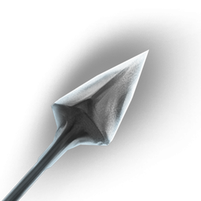

# Eternal Frost Arrow II

| | |
|---|---|
| Category | [Ammunition & Spells](../../categories/ammunition.md) |
| Rarity | 🟣 Epic |
| Level | 28 |
| Max stack | 1 |
| Item ID | `945340556` |
| Internal name | `Ammo_T5_Arrow_Magic_Ice_Eternal_lvl28` |

## Description

A magical arrow that is not used up when shot.

## Where to find

Crafting, Huntress

## Stats

| | |
|---|---|
| Slot | Ammunition |
| Damage type | Ice |
| Mana Cost | 28 |

## Enhancements

Unlocked one after another as the item is upgraded, in this order. Armor and damage bonuses grow with the item level, so their numbers are shown in game only.

| | Enhancement | Effect |
|:---:|---|---|
| 1 | Mana_Cost_Mod | +-5 Mana_Cost_Mod |
| 2 | Mana_Cost_Mod | +-5 Mana_Cost_Mod |
| 3 | Critical Strike Chance Ranged | +3 Precise |
| 4 | Glacial | +5 Glacial |
| 5 | Critical Strike Chance Ranged | +3 Precise |

## How to get it

- **Hunter**: 25 × T5 Ice, 15 × T5 Steel Bar Desc, 1 × [Evil Cyclops Eye](../../items/materials/evil-cyclops-eye-2861211892.md) → 1 ×

---

[← Ammunition & Spells](../../categories/ammunition.md) · [All categories](../../README.md)
