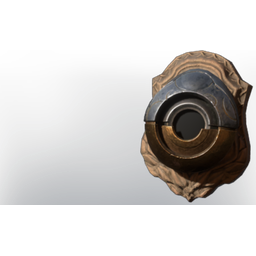

# Ancient Construct: Heavy Trophy

| | |
|---|---|
| Category | [Building](../../categories/buildtools.md) |
| Rarity | 🔵 Rare |
| Level | - |
| Max stack | 10 |
| Item ID | `825905286` |
| Internal name | `_Prop_Decoration_Boss_Trophy_Ancient_Construct_Heavy_01_wood` |

## Description

A severed Ancient Construct: Heavy Head. Collect multiple to craft the trophy

## Lore

> Comfort - Trophy

## Stats

| | |
|---|---|
| Comfort - Trophy | 1 |

## How to get it

- **Hunter**: 2 × [Wood Planks](../../items/materials/wood-planks-1626290897.md), 1 × [Ancient Construct: Heavy Head](../../items/materials/ancient-construct-heavy-head-2477070271.md), 2 × [Nails](../../items/materials/nails-2743545700.md) → 1 ×

---

[← Building](../../categories/buildtools.md) · [All categories](../../README.md) · [JSON](ancient-construct-heavy-trophy-825905286.json)
