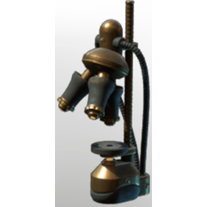

# Ancient Microscope II

| | |
|---|---|
| Category | [Building](../../categories/buildtools.md) |
| Rarity | ⚪ Common |
| Level | - |
| Max stack | 50 |
| Item ID | `758912437` |
| Internal name | `Prop_Decoration_T7_Ancient_Cultivation_Microscope_01_b` |

## Description

A decorative object to design and beautify yout home.

## Lore

> Furniture

## How to get it

- **Carpenter Decoration Workbench**: 1 × [Gold Bars](../../items/materials/gold-bars-514509650.md), 1 × [Celesthium Bars](../../items/materials/celesthium-bars-2893592883.md) → 1 ×

---

[← Building](../../categories/buildtools.md) · [All categories](../../README.md)
