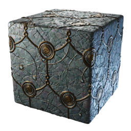

# Ancient Moon Stone Block

| | |
|---|---|
| Category | [Building](../../categories/buildtools.md) |
| Rarity | ⚪ Common |
| Level | - |
| Max stack | 5000 |
| Item ID | `454345705` |
| Internal name | `_Block_T7_Stone_Ancient_Moonstone_CRAFTING` |

## Description

Ancoent Moon Stone Block description

## Where to find

Workbench

## How to get it

- **Workbench**: 10 × Moonstone, 4 × [Sparkling Dust](../../items/materials/sparkling-dust-844454296.md), 3 × [T7 material Ancient Land granite stone](../../items/materials/t7-material-ancient-land-granite-stone-2851443310.md) → 100 ×

---

[← Building](../../categories/buildtools.md) · [All categories](../../README.md) · [JSON](ancient-moon-stone-block-454345705.json)
