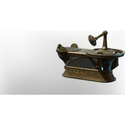

# Ancinet Workbench

| | |
|---|---|
| Category | [Building](../../categories/buildtools.md) |
| Rarity | ⚪ Common |
| Level | - |
| Max stack | 1 |
| Item ID | `2941673930` |
| Internal name | `Craftingstation_Workbench_Ancient_Variation` |

## Description

Craft blocks, new items and repair broken equipment. 

The Workbench can only be placed inside the area of an altar.

This Ancient Workbench is only a visual varaition of the normal workbench.

## Lore

> Furniture

## How to get it

- **Archeologist**: 2 × [Celesthium Bars](../../items/materials/celesthium-bars-2893592883.md), 10 × [T7 material Ancient Land granite stone](../../items/materials/t7-material-ancient-land-granite-stone-2851443310.md), 6 × [Archaic Shards](../../items/materials/archaic-shards-2141541288.md) → 1 ×

---

[← Building](../../categories/buildtools.md) · [All categories](../../README.md) · [JSON](ancinet-workbench-2941673930.json)
