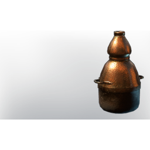

# Athanor

| | |
|---|---|
| Category | [Building](../../categories/buildtools.md) |
| Rarity | 🔵 Rare |
| Level | - |
| Max stack | 1 |
| Item ID | `3002231083` |
| Internal name | `Prop_Component_Athanor` |

## Description

Designed to heat substances under a permanent temperature this oven opens up new alchemical possibilities.

## Lore

> Furniture

## Where to find

Crafting, Alchemist

## How to get it

- **Alchemist**: 10 × [Glass](../../items/materials/glass-2246309017.md), 10 × [Bronze Bars](../../items/materials/bronze-bars-642002617.md), 5 × [Lump of Clay](../../items/materials/lump-of-clay-1925006089.md) → 1 ×

## Used to make

[Laboratory](../../items/buildtools/laboratory-1750422149.md)

---

[← Building](../../categories/buildtools.md) · [All categories](../../README.md) · [JSON](athanor-3002231083.json)
