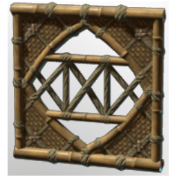

# Bamboo Window III

| | |
|---|---|
| Category | [Building](../../categories/buildtools.md) |
| Rarity | ⚪ Common |
| Level | - |
| Max stack | 50 |
| Item ID | `4182429771` |
| Internal name | `Prop_Decoration_T6_Windows_Frame_Bamboo_01` |

## Description

A decorative object to design and beautify yout home.

## Lore

> Furniture

## How to get it

- **Carpenter**: 5 × [Bamboo Logs](../../items/materials/bamboo-logs-1381084162.md), 2 × [String](../../items/materials/string-419344916.md), 3 × [Palm Leaves](../../items/materials/palm-leaves-521230189.md) → 1 ×

---

[← Building](../../categories/buildtools.md) · [All categories](../../README.md) · [JSON](bamboo-window-iii-4182429771.json)
