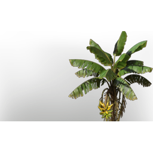

# Banana Seedling

| | |
|---|---|
| Category | [Building](../../categories/buildtools.md) |
| Rarity | ⚪ Common |
| Level | - |
| Max stack | 100 |
| Item ID | `3955544954` |
| Internal name | `T6_Seedling_Banana` |

## Description

A seedling that will grow into a plant when sown in the right soil. Once fully grown, it can be harvested repeatedly.

## Lore

> Seedlings

## Where to find

Seedbed

---

[← Building](../../categories/buildtools.md) · [All categories](../../README.md)
