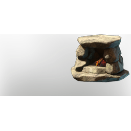

# Basic Fire Place

| | |
|---|---|
| Category | [Building](../../categories/buildtools.md) |
| Rarity | ⚪ Common |
| Level | - |
| Max stack | 50 |
| Item ID | `2553759691` |
| Internal name | `Prop_Decoration_Comfort1_T0_Hearth_FirePlace` |

## Description

A fire place that can be placed in your home to provide warmth. It's basic but does the trick helping you to get a good rested buff.

## Lore

> Hearth

## Stats

| | |
|---|---|
| Cold Resistance | 3 |
| Comfort - Hearth | 1 |

## How to get it

- **Workbench**: 6 × [Stone](../../items/materials/stone-631520303.md), 2 × [Wood Logs](../../items/materials/wood-logs-722268629.md) → 1 ×

---

[← Building](../../categories/buildtools.md) · [All categories](../../README.md) · [JSON](basic-fire-place-2553759691.json)
