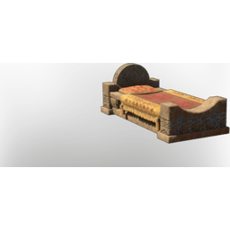

# Bed T3

| | |
|---|---|
| Category | [Building](../../categories/buildtools.md) |
| Rarity | ⚪ Common |
| Level | - |
| Max stack | 50 |
| Item ID | `3415766653` |
| Internal name | `Prop_Decoration_Comfort5_T3_Bed` |

## Description

A decorative item that can be placed in your home.

Provides **comfort** which increases the duration of the Rested Bonus.

## Lore

> Furniture

## Stats

| | |
|---|---|
| Comfort (Category Bed) | 5 |

## How to get it

- **Carpenter**: 10 × [Torn Cloth](../../items/materials/torn-cloth-1496290527.md), 20 × [Lime Stone](../../items/materials/lime-stone-3445636557.md), 10 × [String](../../items/materials/string-419344916.md), 4 × [Indigo Plant](../../items/materials/indigo-plant-4276529065.md), 20 × [Straw](../../items/materials/straw-3921293392.md), 4 × [Green Mushroom Meat](../../items/materials/green-mushroom-meat-90588998.md) → 1 ×

---

[← Building](../../categories/buildtools.md) · [All categories](../../README.md)
