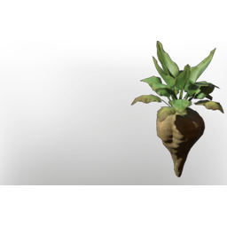

# Beet Seedling

| | |
|---|---|
| Category | [Building](../../categories/buildtools.md) |
| Rarity | ⚪ Common |
| Level | - |
| Max stack | 100 |
| Item ID | `2721454042` |
| Internal name | `T2_Seedling_Vegetable_Beets` |

## Description

A seedling that will grow into a plant when sown in the right soil. Once fully grown, it can be harvested once.

## Lore

> Seedlings

## Where to find

Seedbed

## How to get it

- **Seedbed**: 1 × [Farm Soil](../../items/materials/farm-soil-1823674426.md), 1 × [Forest Beet](../../items/consumables/forest-beet-3542827745.md) → 5 ×

---

[← Building](../../categories/buildtools.md) · [All categories](../../README.md)
