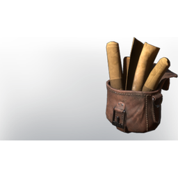

# Big Almanach of Plants and Seedlings

| | |
|---|---|
| Category | [Building](../../categories/buildtools.md) |
| Rarity | 🔵 Rare |
| Level | - |
| Max stack | 1 |
| Item ID | `869257370` |
| Internal name | `Prop_NPC_T3_Almanach_Cooking` |

## Description

Explains how to grow all sorts of seedlings.

## Lore

> Furniture

## Where to find

Farmer

## How to get it

- **Farmer**: 25 × [Paper](../../items/materials/paper-287018928.md), 5 × [String](../../items/materials/string-419344916.md) → 1 ×

---

[← Building](../../categories/buildtools.md) · [All categories](../../README.md) · [JSON](big-almanach-of-plants-and-seedlings-869257370.json)
