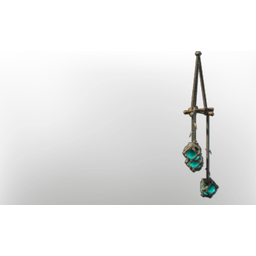

# Blue Pendant Light II

| | |
|---|---|
| Category | [Building](../../categories/buildtools.md) |
| Rarity | ⚪ Common |
| Level | - |
| Max stack | 50 |
| Item ID | `939235192` |
| Internal name | `Prop_Decoration_Comfort_T6_IlluminationCeiling1_blue` |

## Description

An illumination item that can be placed in your home.

Provides **comfort** which increases the duration of the Rested Bonus.

## Lore

> Illumination

## Stats

| | |
|---|---|
| Comfort - Illumination | 6 |

## How to get it

- **Carpenter**: 3 × [Glass](../../items/materials/glass-2246309017.md), 3 × [String](../../items/materials/string-419344916.md), 1 × [Underwater Luminous Growth](../../items/materials/underwater-luminous-growth-1068232992.md), 1 × [Bamboo Logs](../../items/materials/bamboo-logs-1381084162.md), 5 × Drak Teeth, 5 × [Aquamarine Dust](../../items/materials/aquamarine-dust-554104227.md) → 1 ×

---

[← Building](../../categories/buildtools.md) · [All categories](../../README.md)
