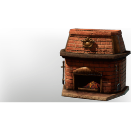

# Brick Fireplace

| | |
|---|---|
| Category | [Building](../../categories/buildtools.md) |
| Rarity | ⚪ Common |
| Level | - |
| Max stack | 50 |
| Item ID | `4243711088` |
| Internal name | `Prop_Decoration_Comfort4_T3_Hearth_FirePlace` |

## Description

A wonderfully inviting fireplace made from red bricks.

## Lore

> Hearth

## Stats

| | |
|---|---|
| Comfort - Hearth | 4 |
| Cold Resistance | 3 |

## How to get it

- **Carpenter**: 5 × [Bronze Bars](../../items/materials/bronze-bars-642002617.md), 20 × [Fired Brick](../../items/materials/fired-brick-1261933427.md) → 1 ×

---

[← Building](../../categories/buildtools.md) · [All categories](../../README.md) · [JSON](brick-fireplace-4243711088.json)
