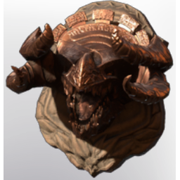

# Bronze Hydrak'Dal Trophy

| | |
|---|---|
| Category | [Building](../../categories/buildtools.md) |
| Rarity | 🟣 Epic |
| Level | - |
| Max stack | 10 |
| Item ID | `645413968` |
| Internal name | `_Prop_Decoration_Boss_Trophy_Drak_Heavy_02_bronze` |

## Description

A severed Hollow Heavy Hero Head. Collect multiple to craft the bronze trophy

## Lore

> Comfort - Trophy

## Stats

| | |
|---|---|
| Comfort - Trophy | 3 |

## How to get it

- **Hunter**: 2 × [Wood Planks](../../items/materials/wood-planks-1626290897.md), 2 × [Hydrak'Dal Head](../../items/materials/hydrak-dal-head-345631469.md), 2 × [Nails](../../items/materials/nails-2743545700.md), 1 × [Bronze Bars](../../items/materials/bronze-bars-642002617.md) → 1 ×

---

[← Building](../../categories/buildtools.md) · [All categories](../../README.md) · [JSON](bronze-hydrak-dal-trophy-645413968.json)
