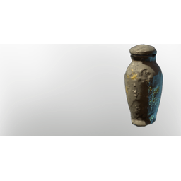

# Carved Limestone Vase I

| | |
|---|---|
| Category | [Building](../../categories/buildtools.md) |
| Rarity | ⚪ Common |
| Level | - |
| Max stack | 50 |
| Item ID | `1159659567` |
| Internal name | `Prop_Decoration_T3_Vase_LimeStone_01` |

## Description

A decorative object to design and beautify yout home.

## Lore

> Furniture

## How to get it

- **Carpenter Decoration Workbench**: 5 × [Lime Stone](../../items/materials/lime-stone-3445636557.md) → 1 ×

---

[← Building](../../categories/buildtools.md) · [All categories](../../README.md) · [JSON](carved-limestone-vase-i-1159659567.json)
