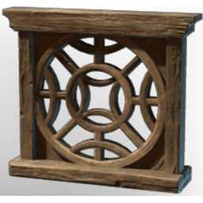

# Carved Wooden Window Frame

| | |
|---|---|
| Category | [Building](../../categories/buildtools.md) |
| Rarity | ⚪ Common |
| Level | - |
| Max stack | 50 |
| Item ID | `3848003771` |
| Internal name | `Prop_Decoration_T1_Window_Round_Carved_Large_Wooden_Frame` |

One of 2 versions of this item: see [Carved Wooden Window Frame](../../objects/buildtools/carved-wooden-window-frame.md) for all of them and how they differ.

## Description

A decorative object to design and beautify yout home.

## Lore

> Furniture

## How to get it

- **Carpenter**: 6 × [Wood Logs](../../items/materials/wood-logs-722268629.md), 4 × [Nails](../../items/materials/nails-2743545700.md) → 1 ×

---

[← Building](../../categories/buildtools.md) · [All categories](../../README.md) · [JSON](carved-wooden-window-frame-3848003771.json)
