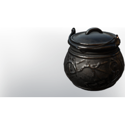

# Cauldron

| | |
|---|---|
| Category | [Building](../../categories/buildtools.md) |
| Rarity | 🔵 Rare |
| Level | - |
| Max stack | 1 |
| Item ID | `311508484` |
| Internal name | `Prop_Component_T5_Black_Cauldron` |

One of 2 versions of this item: see [Cauldron](../../objects/buildtools/cauldron.md) for all of them and how they differ.

## Description

A centerpiece for the Alchemical Station.

## Lore

> Furniture

## How to get it

- **Blacksmith**: 3 × [Iron Bars](../../items/materials/iron-bars-159114158.md), 2 × [Copper Bar](../../items/materials/copper-bar-170689373.md), 15 × [Bonemeal](../../items/materials/bonemeal-2982735558.md) → 1 ×

## Used to make

[Alchemical Station](../../items/buildtools/alchemical-station-3764911324.md)

---

[← Building](../../categories/buildtools.md) · [All categories](../../README.md) · [JSON](cauldron-311508484.json)
