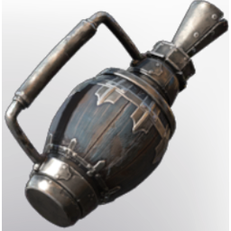

# Channelled Water Tool

| | |
|---|---|
| Category | [Building](../../categories/buildtools.md) |
| Rarity | 🟣 Epic |
| Level | 40 |
| Max stack | 1 |
| Item ID | `1053852637` |
| Internal name | `Tool_T3_Channelled_Water_Hose_Tool` |

## Description

Use this to add water to your base

## Lore

> Tools

## How to get it

- **Blacksmith**: 2 × [Bronze Bars](../../items/materials/bronze-bars-642002617.md), 1 × [Leather](../../items/materials/leather-4135223598.md), 4 × [Wood Planks](../../items/materials/wood-planks-1626290897.md) → 1 ×

---

[← Building](../../categories/buildtools.md) · [All categories](../../README.md)
