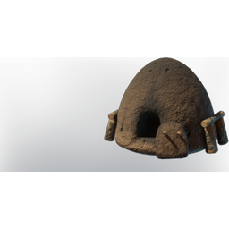

# Charcoal Kiln

| | |
|---|---|
| Category | [Building](../../categories/buildtools.md) |
| Rarity | 🔵 Rare |
| Level | - |
| Max stack | 1 |
| Item ID | `367322414` |
| Internal name | `Prop_Production_T1_Charcoal_Kiln` |

## Description

A heap of wood covered with soil, able to produce Charcoal over time.

## Lore

> Furniture

## Where to find

Blacksmith

## How to get it

- **Blacksmith**: 20 × [Stone](../../items/materials/stone-631520303.md) → 1 ×

---

[← Building](../../categories/buildtools.md) · [All categories](../../README.md)
