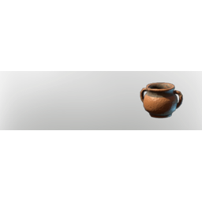

# Clay Vase IV

| | |
|---|---|
| Category | [Building](../../categories/buildtools.md) |
| Rarity | ⚪ Common |
| Level | - |
| Max stack | 50 |
| Item ID | `1410543018` |
| Internal name | `Prop_Decoration_T2_Vase_Clay_04` |

## Description

A decorative object to design and beautify yout home.

## Lore

> Furniture

## How to get it

- **Kiln**: 1 × [Lump of Clay](../../items/materials/lump-of-clay-1925006089.md), 1 × one of: [Wood Logs](../../items/materials/wood-logs-722268629.md) / [Hardwood](../../items/materials/hardwood-1765656585.md) / [Palmwood Logs](../../items/materials/palmwood-logs-2955233340.md) / [Conifer Logs](../../items/materials/conifer-logs-1475408789.md) / … (6 options) → 4 ×

---

[← Building](../../categories/buildtools.md) · [All categories](../../README.md) · [JSON](clay-vase-iv-1410543018.json)
