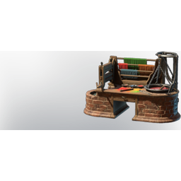

# Coloring Station

| | |
|---|---|
| Category | [Building](../../categories/buildtools.md) |
| Rarity | 🔵 Rare |
| Level | - |
| Max stack | 1 |
| Item ID | `3229096192` |
| Internal name | `_Prop_Production_T2_ColoringStation` |

## Description

Factory for producing palettes and to color your outfits

## Lore

> Furniture

## Where to find

Crafting, Alchemist

## How to get it

- **Alchemist**: 8 × [Wood Planks](../../items/materials/wood-planks-1626290897.md), 10 × [Fired Brick](../../items/materials/fired-brick-1261933427.md), 2 × [Metal Sheets](../../items/materials/metal-sheets-4271896226.md), 2 × [Linnen](../../items/materials/linnen-1815424180.md) → 1 ×

---

[← Building](../../categories/buildtools.md) · [All categories](../../README.md)
