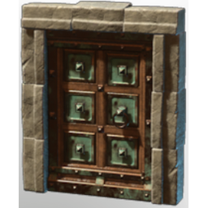

# Copper Door

| | |
|---|---|
| Category | [Building](../../categories/buildtools.md) |
| Rarity | ⚪ Common |
| Level | - |
| Max stack | 50 |
| Item ID | `3608731525` |
| Internal name | `Prop_Decoration_T2_Door_Copper` |

## Description

A decorative object to design and beautify yout home.

## Lore

> Furniture

## How to get it

- **Carpenter**: 10 × [Deepforest Stone](../../items/materials/deepforest-stone-1181280513.md), 6 × [Copper Bar](../../items/materials/copper-bar-170689373.md), 3 × [Metal Scraps](../../items/materials/metal-scraps-132545371.md) → 1 ×

## Used to make

[Coppern Double Door](../../items/buildtools/coppern-double-door-1595396826.md)

---

[← Building](../../categories/buildtools.md) · [All categories](../../README.md) · [JSON](copper-door-3608731525.json)
