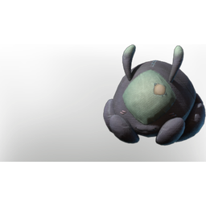

# Critter Plush

| | |
|---|---|
| Category | [Building](../../categories/buildtools.md) |
| Rarity | ⚪ Common |
| Level | - |
| Max stack | 50 |
| Item ID | `961402268` |
| Internal name | `Prop_Decoration_Comfort_T6_Plush_Critter` |

## Description

critter plush desc

## Lore

> Furniture

## Stats

| | |
|---|---|
| Comfort - Wellness | 3 |

## How to get it

- **Farmer**: 5 × [String](../../items/materials/string-419344916.md), 1 × [T2 Palette 02 shades of grey](../../items/colorpalette/t2-palette-02-shades-of-grey-556297753.md) → 1 ×

---

[← Building](../../categories/buildtools.md) · [All categories](../../README.md)
