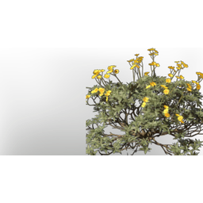

# Desert Flower Seedling

| | |
|---|---|
| Category | [Building](../../categories/buildtools.md) |
| Rarity | ⚪ Common |
| Level | - |
| Max stack | 100 |
| Item ID | `2024314426` |
| Internal name | `T4_Seedling_Desert_flower` |

## Description

A seedling that will grow into a plant when sown in the right soil. Once fully grown, it can be harvested once.

## Lore

> Seedlings

## Where to find

Seedbed

## How to get it

- **Seedbed**: 1 × [Desert Flower](../../items/materials/desert-flower-1024666423.md), 1 × one of: [Sand](../../items/materials/sand-2493843175.md) / [Fine Sand](../../items/materials/fine-sand-3489782185.md) / [T6 Wetlands Sand](../../items/materials/t6-wetlands-sand-2181045178.md) / [T7 AncientLand Sand](../../items/materials/t7-ancientland-sand-3899759098.md) → 5 ×

---

[← Building](../../categories/buildtools.md) · [All categories](../../README.md)
