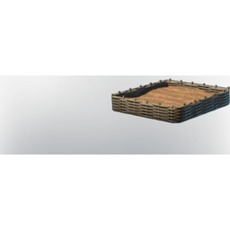

# Empty Farmbed

| | |
|---|---|
| Category | [Building](../../categories/buildtools.md) |
| Rarity | 🔵 Rare |
| Level | - |
| Max stack | 10 |
| Item ID | `1392367211` |
| Internal name | `Prop_Decoration_Farmbed_01b` |

One of 5 versions of this item: see [Empty Farmbed](../../objects/buildtools/empty-farmbed.md) for all of them and how they differ.

## Description

This Farmbed can be filled with Dirt, Sand or Soil to grow plants.

---

[← Building](../../categories/buildtools.md) · [All categories](../../README.md) · [JSON](empty-farmbed-1392367211.json)
