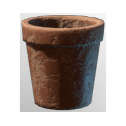

# Empty Flower Pot III

| | |
|---|---|
| Category | [Building](../../categories/buildtools.md) |
| Rarity | ⚪ Common |
| Level | - |
| Max stack | 50 |
| Item ID | `1882339175` |
| Internal name | `Empty_Flower_Pot_Small_Empty` |

## Description

A lovely pot of flowers to beautify your world.

## Lore

> Potted Plant

## Where to find

Crafting, Kiln

## How to get it

- **Kiln**: 1 × [Lump of Clay](../../items/materials/lump-of-clay-1925006089.md), 1 × one of: [Wood Logs](../../items/materials/wood-logs-722268629.md) / [Hardwood](../../items/materials/hardwood-1765656585.md) / [Palmwood Logs](../../items/materials/palmwood-logs-2955233340.md) / [Conifer Logs](../../items/materials/conifer-logs-1475408789.md) / … (6 options) → 4 ×

## Used to make

[Small Monstera Plant Pot](../../items/buildtools/small-monstera-plant-pot-523366717.md), [Fern Pot](../../items/buildtools/fern-pot-2019603203.md), [Gras Pot](../../items/buildtools/gras-pot-4231642797.md), [Pink Flower Pot](../../items/buildtools/pink-flower-pot-1682046505.md), [Red Flower Pot](../../items/buildtools/red-flower-pot-157147909.md), [White Flower Pot](../../items/buildtools/white-flower-pot-120176694.md), [Yellow Flower Pot](../../items/buildtools/yellow-flower-pot-1594649719.md), [Pink Wall Pot](../../items/buildtools/pink-wall-pot-533905592.md), [Red Wall Pot](../../items/buildtools/red-wall-pot-2029375274.md), [White Wall Pot](../../items/buildtools/white-wall-pot-1763603908.md), [Yellow Wall Pot](../../items/buildtools/yellow-wall-pot-2862328564.md)

---

[← Building](../../categories/buildtools.md) · [All categories](../../README.md)
