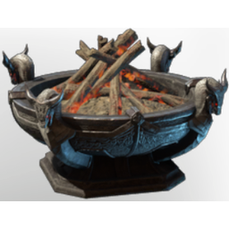

# Epic Dragon Brazier

| | |
|---|---|
| Category | [Building](../../categories/buildtools.md) |
| Rarity | ⚪ Common |
| Level | - |
| Max stack | 50 |
| Item ID | `3395224471` |
| Internal name | `Prop_Decoration_Comfort_T5_IlluminationFloor_Brazier_Dragon` |

## Description

A decorative Item, which will provide warmth and illumination in its proximitye .

Provides **comfort** which increases the duration of the Rested Bonus.

## Lore

> Hearth

## Stats

| | |
|---|---|
| Cold Resistance | 5 |
| Comfort - Hearth | 5 |

## How to get it

- **Carpenter**: 5 × [Wood Logs](../../items/materials/wood-logs-722268629.md), 15 × T5 Steel Bar Desc, 15 × T5 Material Coal Name → 1 ×

---

[← Building](../../categories/buildtools.md) · [All categories](../../README.md) · [JSON](epic-dragon-brazier-3395224471.json)
