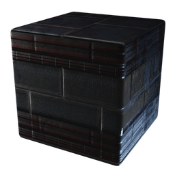

# Fallen Crypt Block

| | |
|---|---|
| Category | [Building](../../categories/buildtools.md) |
| Rarity | ⚪ Common |
| Level | - |
| Max stack | 5000 |
| Item ID | `2041116756` |
| Internal name | `Block_T1_HollowHalls_Stone_HallowHalls_REWARD` |

## Description

Fallen Crypt Block description

## Where to find

Workbench

## How to get it

- **Workbench**: 5 × [Stone](../../items/materials/stone-631520303.md), 1 × [Tar](../../items/materials/tar-1714627847.md) → 100 ×

---

[← Building](../../categories/buildtools.md) · [All categories](../../README.md) · [JSON](fallen-crypt-block-2041116756.json)
