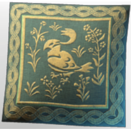

# Flightless Redtail Pillow

| | |
|---|---|
| Category | [Building](../../categories/buildtools.md) |
| Rarity | ⚪ Common |
| Level | - |
| Max stack | 50 |
| Item ID | `1568297956` |
| Internal name | `Prop_Decoration_Comfort_T4_Pillow_Animal_03` |

One of 2 versions of this item: see [Flightless Redtail Pillow](../../objects/buildtools/flightless-redtail-pillow.md) for all of them and how they differ.

## Description

A comfortable pillow with a bird motiv. The bird may not fly, but it looks stylish!

## Lore

> Furniture

## Stats

| | |
|---|---|
| Comfort - Wellness | 5 |

## How to get it

- **Bard**: 3 × [Green Fabric](../../items/materials/green-fabric-2287874170.md), 5 × [Feather](../../items/materials/feather-3838906683.md), 2 × [Plant Fibre](../../items/materials/plant-fibre-3316218728.md), 1 × [String](../../items/materials/string-419344916.md) → 1 ×

---

[← Building](../../categories/buildtools.md) · [All categories](../../README.md) · [JSON](flightless-redtail-pillow-1568297956.json)
