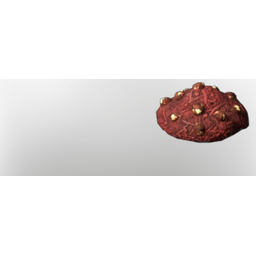

# Food Bunny Feeding

| | |
|---|---|
| Category | [Building](../../categories/buildtools.md) |
| Rarity | ⚪ Common |
| Level | - |
| Max stack | 200 |
| Item ID | `1674254183` |
| Internal name | `Material_T1_Bunny_Feeding` |

## Description

food bunny feeding description

## Where to find

Farmer

## How to get it

- **Farmer**: 1 × [Hazelnut](../../items/consumables/hazelnut-3360608010.md), 1 × [Strawberry](../../items/consumables/strawberry-3479563223.md), 3 × [Corncob](../../items/consumables/corncob-3118804138.md) → 50 ×

---

[← Building](../../categories/buildtools.md) · [All categories](../../README.md) · [JSON](food-bunny-feeding-1674254183.json)
