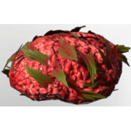

# Food Cat Feeeding

| | |
|---|---|
| Category | [Building](../../categories/buildtools.md) |
| Rarity | ⚪ Common |
| Level | - |
| Max stack | 200 |
| Item ID | `1175242603` |
| Internal name | `Material_T2_Cat_Feeding` |

## Description

food cat feeding description

## Where to find

Farmer

## How to get it

- **Farmer**: 1 × [Raw Lean Meat](../../items/consumables/raw-lean-meat-1492892444.md), 1 × one of: Fish common 02 name / Fish common 03 name / Fish common 01 name → 50 ×

---

[← Building](../../categories/buildtools.md) · [All categories](../../README.md) · [JSON](food-cat-feeeding-1175242603.json)
