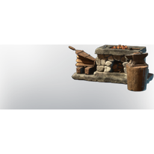

# Forge

| | |
|---|---|
| Category | [Building](../../categories/buildtools.md) |
| Rarity | 🔵 Rare |
| Level | - |
| Max stack | 1 |
| Item ID | `770717366` |
| Internal name | `Prop_Production_T1_Forge` |

## Description

The home and main working place of every Blacksmith.

## Lore

> Furniture

## Where to find

Blacksmith

## How to get it

- **Blacksmith**: 30 × [Stone](../../items/materials/stone-631520303.md), 10 × [Metal Scraps](../../items/materials/metal-scraps-132545371.md), 10 × [Charcoal](../../items/materials/charcoal-372029138.md), 12 × [Wood Logs](../../items/materials/wood-logs-722268629.md) → 1 ×

---

[← Building](../../categories/buildtools.md) · [All categories](../../README.md) · [JSON](forge-770717366.json)
