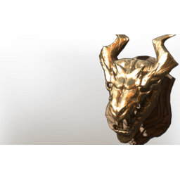

# Gold Hollow Wispwyvern Trophy

| | |
|---|---|
| Category | [Building](../../categories/buildtools.md) |
| Rarity | 🟠 Legendary |
| Level | - |
| Max stack | 10 |
| Item ID | `3996827562` |
| Internal name | `_Prop_Decoration_Boss_Trophy_Skeleton_Lizard_04_gold` |

## Description

A severed Hollow Wispwyvern Head. Collect multiple to craft the golden trophy

## Lore

> Comfort - Trophy

## Stats

| | |
|---|---|
| Comfort - Trophy | 10 |

## How to get it

- **Hunter**: 2 × [Wood Planks](../../items/materials/wood-planks-1626290897.md), 4 × [Skeleton T7 Boss Head](../../items/materials/skeleton-t7-boss-head-2573714663.md), 2 × [Nails](../../items/materials/nails-2743545700.md), 1 × [Gold Bars](../../items/materials/gold-bars-514509650.md) → 1 ×

---

[← Building](../../categories/buildtools.md) · [All categories](../../README.md) · [JSON](gold-hollow-wispwyvern-trophy-3996827562.json)
