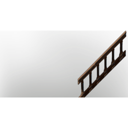

# Handrail

| | |
|---|---|
| Category | [Building](../../categories/buildtools.md) |
| Rarity | ⚪ Common |
| Level | - |
| Max stack | 20 |
| Item ID | `2470943261` |
| Internal name | `Z_Prop_Decoration_T3_Fence_Wood_Stairs_01_OLD_NORECIPE` |

One of 2 versions of this item: see [Handrail](../../objects/buildtools/handrail.md) for all of them and how they differ.

## Description

A decorative object to design and beautify yout home.

## Lore

> Furniture

---

[← Building](../../categories/buildtools.md) · [All categories](../../README.md)
