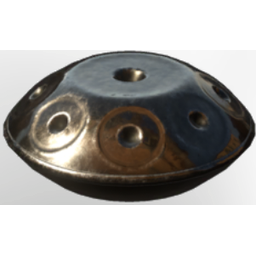

# Hang-Drum

| | |
|---|---|
| Category | [Building](../../categories/buildtools.md) |
| Rarity | ⚪ Common |
| Level | - |
| Max stack | 1 |
| Item ID | `2038549065` |
| Internal name | `Instrument_Hangdrum` |

## Description

A hang drum is a hand-played steel instrument whose gentle tones spread like ripples across still water.

## Lore

> Instruments

## Stats

| | |
|---|---|
| Slot | Tool |
| Comfort | +1 |

## How to get it

- **Bard**: 1 × T5 Steel Bar Desc, 1 × [Iron Dust](../../items/materials/iron-dust-4114143627.md) → 1 ×

---

[← Building](../../categories/buildtools.md) · [All categories](../../README.md) · [JSON](hang-drum-2038549065.json)
