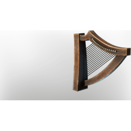

# Harp

| | |
|---|---|
| Category | [Building](../../categories/buildtools.md) |
| Rarity | ⚪ Common |
| Level | - |
| Max stack | 1 |
| Item ID | `134682651` |
| Internal name | `Instrument_Harp` |

## Description

A heavenly harp with silver strings, beloved by common folk and kings alike.

## Lore

> Instruments

## Stats

| | |
|---|---|
| Slot | Tool |
| Comfort | +1 |

## How to get it

- **Bard**: 1 × [Metal Scraps](../../items/materials/metal-scraps-132545371.md), 1 × [String](../../items/materials/string-419344916.md), 2 × [Copper Bar](../../items/materials/copper-bar-170689373.md), 1 × [Linnen](../../items/materials/linnen-1815424180.md), 1 × [Animal Fur](../../items/materials/animal-fur-984234407.md), 1 × [Dried Fur](../../items/materials/dried-fur-3420500473.md) → 1 ×

---

[← Building](../../categories/buildtools.md) · [All categories](../../README.md)
