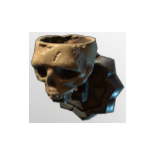

# Illumination T2 Wall Bones

| | |
|---|---|
| Category | [Building](../../categories/buildtools.md) |
| Rarity | ⚪ Common |
| Level | - |
| Max stack | 50 |
| Item ID | `242624234` |
| Internal name | `Prop_Decoration_Comfort_T2_Illumination_Wall_HollowHalls_Bone` |

## Description

An illumination item that can be placed in your home.

Provides **comfort** which increases the duration of the Rested Bonus.

## Lore

> Illumination

## Stats

| | |
|---|---|
| Comfort - Illumination | 2 |

## How to get it

- **Collector**: 1 × [Krypt Krystal](../../items/materials/krypt-krystal-3953523416.md), 1 × [Metal Scraps](../../items/materials/metal-scraps-132545371.md), 1 × [Charcoal](../../items/materials/charcoal-372029138.md), 1 × [Bones](../../items/materials/bones-2053375978.md) → 1 ×

---

[← Building](../../categories/buildtools.md) · [All categories](../../README.md) · [JSON](illumination-t2-wall-bones-242624234.json)
