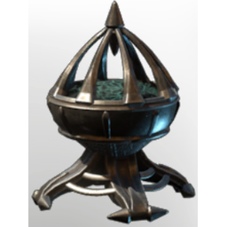

# Illumination T4 Brazier HallowHalls

| | |
|---|---|
| Category | [Building](../../categories/buildtools.md) |
| Rarity | ⚪ Common |
| Level | - |
| Max stack | 50 |
| Item ID | `2021009419` |
| Internal name | `Prop_Decoration_Comfort_T4_Illumination_Floor_HallowHalls_Brazier` |

## Description

A decorative Item, which will provide warmth and illumination in its proximitye .

Provides **comfort** which increases the duration of the Rested Bonus.

## Lore

> Hearth

## Stats

| | |
|---|---|
| Comfort - Hearth | 4 |

## How to get it

- **Collector**: 10 × [Charcoal](../../items/materials/charcoal-372029138.md), 5 × [Iron Bars](../../items/materials/iron-bars-159114158.md), 20 × [Resin](../../items/materials/resin-4109728689.md), 5 × one of: T2 Green Essence / [T3 Green essence](../../items/materials/t3-green-essence-1453689781.md) / T4 Green Essence / T5 Green Essence / … (5 options) → 1 ×

---

[← Building](../../categories/buildtools.md) · [All categories](../../README.md) · [JSON](illumination-t4-brazier-hallowhalls-2021009419.json)
