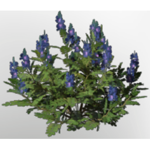

# Indigo Seedling

| | |
|---|---|
| Category | [Building](../../categories/buildtools.md) |
| Rarity | ⚪ Common |
| Level | - |
| Max stack | 100 |
| Item ID | `1533027547` |
| Internal name | `T2_Seedling_Material_Indigo` |

## Description

A seedling that will grow into a plant when sown in the right soil. Once fully grown, it can be harvested once.

## Lore

> Seedlings

## Where to find

Seedbed

## How to get it

- **Seedbed**: 1 × [Indigo Plant](../../items/materials/indigo-plant-4276529065.md), 1 × [Farm Soil](../../items/materials/farm-soil-1823674426.md) → 5 ×

---

[← Building](../../categories/buildtools.md) · [All categories](../../README.md) · [JSON](indigo-seedling-1533027547.json)
