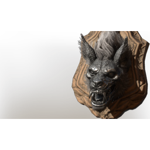

# Iron Werewolf Trophy

| | |
|---|---|
| Category | [Building](../../categories/buildtools.md) |
| Rarity | 🟠 Legendary |
| Level | - |
| Max stack | 10 |
| Item ID | `4057512959` |
| Internal name | `_Prop_Decoration_Boss_Trophy_Wildbeast_Wolf_Heavy_03_iron` |

## Description

A severed Werewolf Head. Collect multiple to craft the iron trophy

## Lore

> Comfort - Trophy

## Stats

| | |
|---|---|
| Comfort - Trophy | 5 |

## How to get it

- **Hunter**: 2 × [Wood Planks](../../items/materials/wood-planks-1626290897.md), 3 × [Wolf Heavy Head](../../items/materials/wolf-heavy-head-1285378490.md), 2 × [Nails](../../items/materials/nails-2743545700.md), 1 × [Iron Bars](../../items/materials/iron-bars-159114158.md) → 1 ×

---

[← Building](../../categories/buildtools.md) · [All categories](../../README.md)
