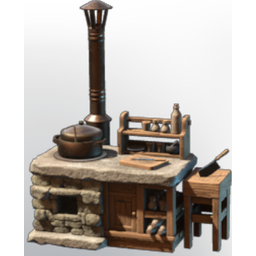

# Kitchen

| | |
|---|---|
| Category | [Building](../../categories/buildtools.md) |
| Rarity | 🔵 Rare |
| Level | - |
| Max stack | 1 |
| Item ID | `3587916203` |
| Internal name | `Craftingstation_Farmer_Kitchen` |

## Description

with the help of the farmer you are able to assemble any dish your heart desires at this food preperation station

## Lore

> Furniture

## Where to find

Farmer

## How to get it

- **Farmer**: 2 × [Copper Bar](../../items/materials/copper-bar-170689373.md), 10 × [Wood Logs](../../items/materials/wood-logs-722268629.md), 2 × [Metal Scraps](../../items/materials/metal-scraps-132545371.md) → 1 ×

---

[← Building](../../categories/buildtools.md) · [All categories](../../README.md) · [JSON](kitchen-3587916203.json)
