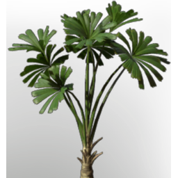

# Licuala Seedling

| | |
|---|---|
| Category | [Building](../../categories/buildtools.md) |
| Rarity | ⚪ Common |
| Level | - |
| Max stack | 100 |
| Item ID | `2883918272` |
| Internal name | `T6_Seedling_Tree_Licuala` |

## Description

A seedling that will soon grow into a plant, should it be placed into the right ground.

## Lore

> Seedlings

## Where to find

Seedbed

## How to get it

- **Seedbed**: 1 × [Palmwood Logs](../../items/materials/palmwood-logs-2955233340.md), 1 × [Fertilised Farm Soil](../../items/materials/fertilised-farm-soil-260133819.md), 1 × [Palm Leaves](../../items/materials/palm-leaves-521230189.md) → 5 ×

---

[← Building](../../categories/buildtools.md) · [All categories](../../README.md)
