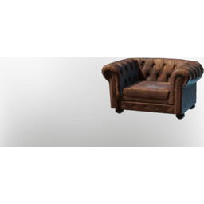

# Low Elegant Armchair

| | |
|---|---|
| Category | [Building](../../categories/buildtools.md) |
| Rarity | ⚪ Common |
| Level | - |
| Max stack | 50 |
| Item ID | `1775964566` |
| Internal name | `Prop_Decoration_Comfort8_T5_SofaChair01` |

## Description

A decorative object to design and beautify yout home.

## Lore

> Furniture

## Stats

| | |
|---|---|
| Comfort - Chair | 8 |

## How to get it

- **Carpenter**: 2 × [Conifer Logs](../../items/materials/conifer-logs-1475408789.md), 1 × [Nails](../../items/materials/nails-2743545700.md), 2 × T5 Padding Kit Warm, 4 × [Wool](../../items/materials/wool-2837376937.md), 2 × T5 Hardened Leather → 1 ×

---

[← Building](../../categories/buildtools.md) · [All categories](../../README.md) · [JSON](low-elegant-armchair-1775964566.json)
