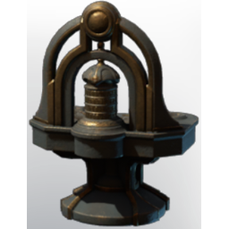

# Magic Infusion Station

| | |
|---|---|
| Category | [Building](../../categories/buildtools.md) |
| Rarity | 🔵 Rare |
| Level | - |
| Max stack | 1 |
| Item ID | `2501086572` |
| Internal name | `Prop_Production_T7_Infusion_Station` |

## Description

It produces XY which can be used to magically infuse tools and create powerful items at the ancient researcher.

## Lore

> Furniture

## Where to find

Crafting, Ancient Researcher

## How to get it

- **Archeologist**: 30 × [T7 material Ancient Land granite stone](../../items/materials/t7-material-ancient-land-granite-stone-2851443310.md), 10 × [Gold Dust](../../items/materials/gold-dust-1060230019.md), 5 × [Celesthium Bars](../../items/materials/celesthium-bars-2893592883.md), 1 × [Moonstone Dust](../../items/materials/moonstone-dust-4078086541.md), 1 × [Diamond Dust](../../items/materials/diamond-dust-1725874983.md) → 1 ×

---

[← Building](../../categories/buildtools.md) · [All categories](../../README.md)
