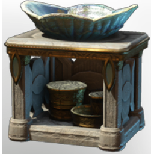

# Maritime Sink

| | |
|---|---|
| Category | [Building](../../categories/buildtools.md) |
| Rarity | ⚪ Common |
| Level | - |
| Max stack | 50 |
| Item ID | `101619585` |
| Internal name | `Prop_Decoration_Comfort8_T6_BathroomSink` |

## Description

A decorative item that can be placed in your home.

Provides **comfort** which increases the duration of the Rested Bonus.

## Lore

> Furniture

## Stats

| | |
|---|---|
| Comfort - Sink | 8 |

## How to get it

- **Carpenter**: 6 × T6 material limestone from shells, 1 × [Gold Bars](../../items/materials/gold-bars-514509650.md), 1 × [Gold Dust](../../items/materials/gold-dust-1060230019.md), 10 × [Mother-Of-Pearl](../../items/materials/mother-of-pearl-1898288525.md) → 1 ×

---

[← Building](../../categories/buildtools.md) · [All categories](../../README.md) · [JSON](maritime-sink-101619585.json)
